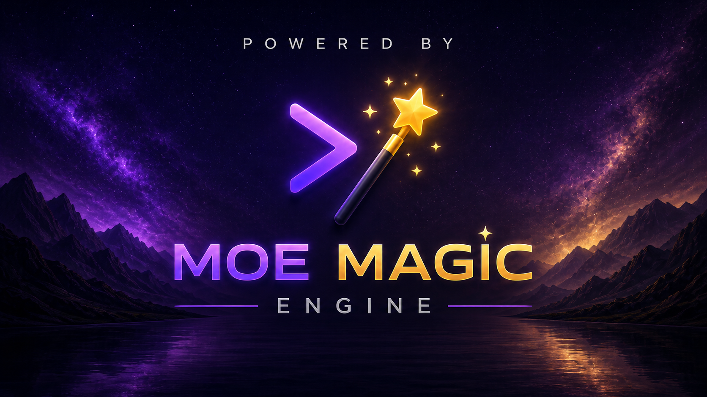

  

  

<h1 align="center">Moe Magic Engine</h1>

  A lightweight Windows-first 3D game engine and visual editor with a Unity-familiar Scene/GameObject/Component workflow, Lua gameplay scripting, physics, animation, audio, UI, particles, standalone Windows builds, and WebGL2/WebAssembly browser builds.

  <a href="https://github.com/mra1991/MoeMagicEngine/releases/latest"><strong>Download the latest release</strong></a>
  ·
  <a href="https://patreon.com/MoeMagicEngine"><strong>Support on Patreon</strong></a>

---

**Current stable release: [v1.12.0 — Composable Action Gameplay and Pre-AI Readiness](https://github.com/mra1991/MoeMagicEngine/releases/tag/v1.12.0).**
Windows x64 editor, standalone Windows games and WebGL2/WebAssembly browser exports.

## 🚀 Quick Start

**Install Moe Magic → Launch → New Project → choose Basic 3D / Ultimate Platformer / Pot Pursuit → Create → Play**

1. [Download the latest installer](https://github.com/mra1991/MoeMagicEngine/releases/latest), install it, and launch **Moe Magic Engine**.
2. Choose **New Project...** in the launcher, or **File → New Project...** in the editor.
3. Pick a template: **Basic 3D** is the small starter; **Ultimate Platformer** and **Pot Pursuit** are complete playable project templates.
4. Enter a project name, choose a writable location outside the installation, and click **Create**. Moe Magic creates your own writable project copy—there are no demo folders to locate manually.
5. For an instant playable example, choose **Ultimate Platformer** or **Pot Pursuit**, then press **Play** in the editor.

Edit your copy freely, then use **File → Build Game...** to make Windows or Web builds from the same project.

**[Play Ultimate Platformer in your browser](https://mra1991.itch.io/ultimate-platformer-coin-run)** — an actual Moe Magic Web build of the included Ultimate Platformer sample.

## ✨ What is Moe Magic?

**Moe Magic Engine** is an independently developed 3D game engine for Windows.

It is designed around a straightforward workflow:

**Create a project → build scenes visually → add reusable Components → write game logic in Lua → Play → Build Game.**

You do **not** need the engine source code, Visual Studio, or C++ to make a game with Moe Magic. Normal gameplay scripting is done in **Lua**.

The engine itself is proprietary, but it is **free to use with no royalties or revenue threshold** for personal, educational, free, and commercial games.

## 🎮 Highlights

- Visual Scene editor with Hierarchy, Inspector, transform gizmos, Scene/Game views, camera guides, and viewport orientation tools
- Component-based GameObjects
- OBJ, supported JSON glTF, and static or bounded skeletal FBX import
- Skeletal animation, authored animation states/markers, LookAt and TwoBoneIK pose constraints
- Materials, PBR lighting, shadows, HDR, bloom, transparency, and graphics-quality presets
- Static, Dynamic, and Kinematic physics
- Capsule Character Controller with keyboard/gamepad support and moving platforms
- Path followers, follow cameras, framing zones and four-wheel arcade vehicles
- Baked navigation, perception and Patrol/Pursue/Return agents
- Hinges, distance springs and terminal ragdolls
- Health, contact damage, stomp/breakable interactions, checkpoints, objectives and rewards
- Bounded runtime prefab spawning, swept projectiles and named Interact actions
- Persistent Windows/browser progress and typed single-base prefab variants
- Keyboard and gamepad Input Actions with runtime rebinding
- 2D and spatial 3D audio
- Canvas UI, menus, HUDs, buttons, and graphical UI images
- Particle bursts and scripted effects
- Project-local Lua gameplay scripting
- Play / Pause / Step / Stop workflow
- Multi-scene projects and scene transitions
- Build Game for standalone Windows players and WebGL2/WASM browser games (**Web**)
- itch.io-ready Web ZIP packaging and built-in local browser preview
- Basic 3D, Ultimate Platformer, and Pot Pursuit templates in New Project
- Configurable editor text size: Compact, Comfortable, or Large
- Built-in offline User Manual and two complete game tutorials
- Searchable Shared Library with dependency-aware Add to Project and provenance/license records

### Editor readability

Introduced in v1 in response to real user feedback, **Edit → Preferences → Editor Text Size** offers **Compact (13)**, **Comfortable (16, default)**, and **Large (18)**. Comfortable gives new users a more readable default on normal displays; Compact keeps the previous denser presentation for larger or multi-monitor setups; Large provides bigger text.

The choice applies without restarting, is also available in the launcher, and persists between sessions. It is separate from layout and game UI text; if preferences cannot be saved, the editor reports that the choice is session-only.

## 🕹 Included sample projects

Both samples are available directly from **New Project** as writable project copies, ready to **Play**.

### Ultimate Platformer

A three-level game: **Sky Orchard**, **Boulder Run**, and **Workshop Rally**. Character platforming,
a chase course and kart driving demonstrate checkpoints/recovery, objectives and optional Gems,
moving ferries, hazards, audio/particles, and project-owned Lua menus/HUDs. Completion and Gem
progress persist, with Continue and confirmed New Game actions.

Sky Orchard also demonstrates a friendly animated attendant, a guard that patrols/pursues/loses
sight behind cover, a swinging/breakaway Workshop route with a permanent bypass, a terminal-ragdoll
sentinel, and an optional lever/gate/cannon/Heart-cache detour with camera framing. These compose
reusable engine Components; they are not hardcoded native game rules.

The [hosted browser demo](https://mra1991.itch.io/ultimate-platformer-coin-run) remains available.
Its uploaded content may lag the current installer; create a fresh sample for the v1.12.0 reference.

### Pot Pursuit

A timed collection game demonstrating:

- project-owned scoring and objectives
- moving hazards
- timed collectibles
- spatial and 2D audio
- animated menu presentation
- Canvas UI
- Lua gameplay logic
- complete menu → gameplay → result flow

## 🌐 Web Builds and itch.io

Moe Magic exports **WebGL2/WebAssembly (WASM)** browser games with an **itch.io-ready ZIP**.
The current target is labeled **Web**; the old Experimental UI label was removed in v1.1.0.
Browser platform limits still apply—this does not promise full Windows parity.

**File → Build Game... → Target: Web → Build Web → Show itch.io ZIP → upload the ZIP unchanged to itch.io as an HTML/browser game**

Save your project and configure **Window → Build Settings** first, using the same Scenes and dependencies as your Windows build. Choose an output location outside the project and installation. Build Web produces a `<game-name>-Web` folder and a `<game-name>-Web-itch.zip` archive, with `index.html` already at the archive root alongside the required assets and notices. On itch.io, enable browser playback/click-to-play; no unpacking or repacking is needed.

The compatible Web runtime and local preview helper ship with Moe Magic. Users do **not** need Node, Python, Emscripten, Visual Studio, or a source checkout to export a Web game.

Choose **Preview** to open the build through localhost, wait for loading, and click **Start Game**. Browser audio requires this normal initial user interaction. **Stop Preview** or closing the editor stops the preview server. If ZIP creation fails, the output folder can still be previewed; fix the reported issue and use **Retry ZIP**.

**[Play Ultimate Platformer in your browser](https://mra1991.itch.io/ultimate-platformer-coin-run)** to try the included sample as a published Moe Magic Web game.

### Current browser support and limits

Current browser limits:

- Use hardware-accelerated desktop **Chrome or Edge** with **WebGL2** and floating-point render-target support. Mobile and Safari are not guaranteed.
- Keyboard and standard gamepads are supported where exposed by the browser. The Character Controller and sample projects support movement, jumping, and runtime menus with these inputs.
- Serve builds through local Preview or a web host; `file://` is unsupported. Wireframe, arbitrary network asset discovery, and automatic graphics-context restoration are unsupported; context loss requires a reload.
- Gameplay and audio pause when the page is hidden or unfocused. Fullscreen requires an explicit action and may be denied by browser policy.
- Browser settings are scoped to the game's origin and URL directory. If browser storage is unavailable, settings are session-only.
- Durable gameplay progress uses bounded host-owned storage (Windows files / browser IndexedDB),
  not cloud synchronization. Private browsing, storage denial or cleared site data affect persistence.
- Graphics-quality options reflect browser support; unsupported startup presets fall back to **Performance**.
- Export limits are **1,000 files**, **240-byte relative paths**, **200 MB per file**, and **500 MB total**, with a stricter **256 MiB** startup-content budget.
- Generated ZIPs use uncompressed entries, so they can be larger than compressed ZIPs.

## 📦 Installation

Moe Magic currently targets **64-bit Windows 10/11**.

1. Open the [latest GitHub Release](https://github.com/mra1991/MoeMagicEngine/releases/latest).
2. Download `MoeMagicEngine-1.12.0-Setup.exe` and its adjacent `.sha256` checksum.
3. Close the editor/Players and run setup. **For upgrades, keep the existing installation folder**;
   setup replaces application files and updates installed-app registration and shortcuts.
4. Launch **Moe Magic Engine** from the Start Menu or optional Desktop shortcut.
5. Choose **New Project**, select **Basic 3D**, **Ultimate Platformer**, or **Pot Pursuit**, and click **Create**. Press **Play** to try either sample immediately.

The installer includes the Editor, compatible Windows Player and Web runtime, local Web preview helper, documentation, project templates, and the selected CC0 starter library.

External projects, preferences and saves are preserved. Existing game copies are not overwritten
with newer samples: create a fresh sample through New Project to explore current content.
Check Help → About and Windows Installed apps show **1.12.0**. See [Getting Started](GETTING_STARTED.md)
for upgrade and project guidance. No background auto-updater is included; running the newer setup
is the upgrade operation, not an intentional side-by-side installation.

> Windows may show an **Unknown Publisher / SmartScreen** warning while the installer is unsigned. Always verify the published SHA-256 checksum if you want to confirm the download.

## 📚 Documentation

Moe Magic includes offline documentation accessible directly from:

**Help → User Manual**

The documentation includes:

- the complete engine User Manual
- an Ultimate Platformer tutorial
- a Pot Pursuit tutorial
- Lua scripting guidance
- authoring, physics, animation, audio, UI, particles, input, and Build Game instructions
- New Project templates, editor text-size preferences, local Web preview, itch.io publishing, and current browser limits
- Shared Library/provenance, skeletal FBX, animation states/constraints, navigation, vehicles,
  physical mechanisms/ragdolls, persistent progress, variants and composable action gameplay

## 🧰 Starter asset library

The installer includes a curated CC0 starter library built from compatible assets by **Kenney**, **Quaternius**, and other CC0 audio creators.

Use **Asset Browser → Shared Library** to search/filter, inspect support and provenance, then
**Plan Add to Project → Add to Project**. Selected dependencies and notices become project-owned
copies; assignment/instantiation is a separate action. Exact existing copies report AlreadyPresent;
edited/incomplete copies report Conflict, without silently overwriting them. Players never mount
the shared library. Build Game packages the saved project's actual declared dependencies.

Third-party assets retain their original licenses and provenance notices.

Import is deliberately bounded: not every glTF/FBX export is supported. GLB, morph animation,
arbitrary FBX constraints and over-four-influence skins are not silently converted. The supplied
Worker_Male_Moe4 sample is an explicitly documented derivative. AudioClips use supported WAV;
source OGGs need external conversion. There is no public AI Designer, general animation graph,
full-body IK, arbitrary runtime Component creation or cloud-save service.

## 💜 Support Moe Magic

Moe Magic is independently developed by **Mohammadreza (Moe) Abolhassani**.

If you enjoy the engine and want to support continued development, documentation, examples, and future versions:

### ⭐ [Support Moe Magic on Patreon](https://patreon.com/MoeMagicEngine)

There are no royalties or revenue thresholds for games made with Moe Magic.

## 📜 License

Moe Magic Engine is **free proprietary software**, not open source.

In summary:

- You may use the supplied engine binaries for personal, educational, free, or commercial games.
- You keep ownership of your own game content and code.
- You may distribute the required Moe Magic Player/runtime with games built using Moe Magic.
- The built-in Moe Magic startup branding and required notices must remain intact.
- The Editor and engine source may not be redistributed or rebranded as another engine product without permission.
- Bundled third-party assets remain governed by their own licenses.

See [`LICENSE.txt`](LICENSE.txt) for the full terms.

## 💻 Current release

**v1.12.0 — Current Stable Public Release**

Download the installer and matching SHA-256 from the [v1.12.0 release](https://github.com/mra1991/MoeMagicEngine/releases/tag/v1.12.0).
That page records the exact current artifact size/checksum and any transparent replacement notice.
The release includes the editor, Windows/Web runtimes, preview helper, current offline guides,
three New Project choices and the selected licensed Shared Library.

## 🪄 Development history

Moe Magic has been built incrementally, with each version family establishing another part of the engine:

| Family | Main focus |
| --- | --- |
| **v0.0.x** | Core architecture, rendering, GameObjects, assets, lighting, hierarchy, and Scene persistence |
| **v0.1.x** | Interactive editor workflow, viewport tools, undo/redo, and docked workspace |
| **v0.2.x** | Play Mode, runtime isolation, native Behaviours, input, destruction, cameras, and triggers |
| **v0.3.x** | Early complete gameplay workflows, licensed model library, Scene usability, and prefabs |
| **v0.4.x** | Standalone Player foundation and portable Windows development builds |
| **v0.5.x** | Rigid-body physics, collider shapes, Kinematic motion, spatial queries, and Character Controller |
| **v0.6.x** | Input Actions, gamepad support, Canvas UI, fullscreen Player presentation, and rebinding |
| **v0.7.x** | 2D audio, spatial audio, listener support, and gameplay-driven sound |
| **v0.8.x** | glTF import, skeletal animation, Scene transitions, and authored Main Menu flow |
| **v0.9.x** | Rendering and presentation: lighting, shadows, PBR, HDR, bloom, particles, and quality presets |
| **v0.10.x** | Embedded Lua gameplay scripting and progressively richer user-side APIs |
| **v0.11.x** | Project workflows, recovery, project-scoped operations, dependency diagnostics, and asset reload |
| **v0.12.x** | Project-owned gameplay, multi-project workflow, user documentation, installer, sample projects, and public-distribution readiness |
| **v1.0.x** | Stable conventional engine baseline: Windows distribution, experimental Web builds, itch.io packaging, improved editor readability, and sample templates with a straightforward New Project workflow |
| **v1.1–v1.4** | Static FBX and asset publishing, bounded runtime prefabs, reusable platformer interactions, checkpoints and objectives |
| **v1.5–v1.8** | Paths/follow cameras, arcade vehicles and three-level sample, skeletal FBX/state controllers, navigation/perception |
| **v1.9–v1.12** | Physical mechanisms/ragdolls, pose constraints, persistent progress/prefab variants, interaction/projectiles/framing and bounded composition-readiness inventory |

---

  <strong>Moe Magic Engine</strong> 
  Developed by Mohammadreza (Moe) Abolhassani

