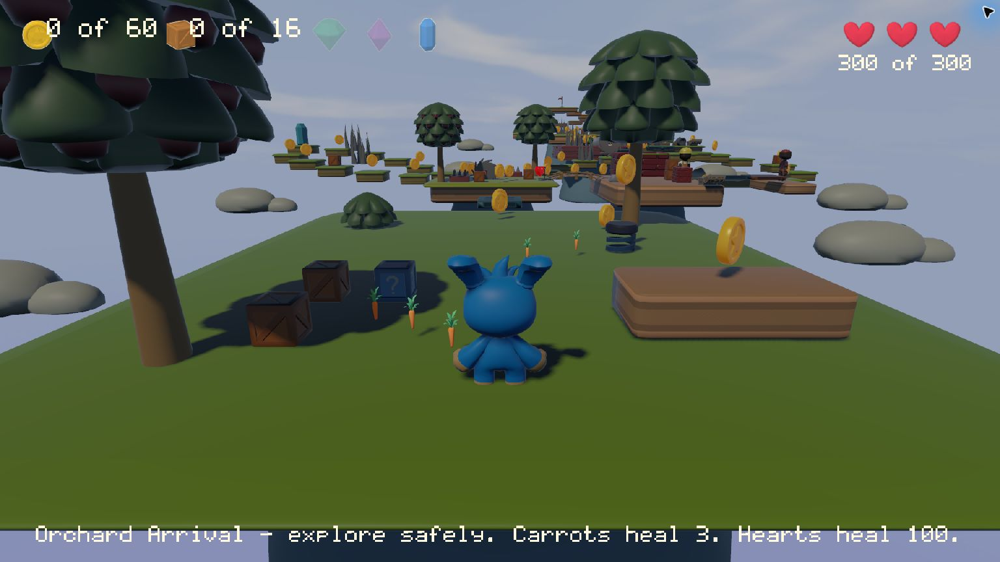
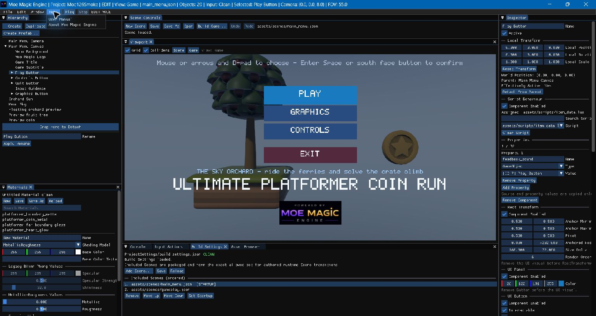

# Ultimate Platformer — Complete Game Tutorial

## Curved Boulder Run (v1.16 candidate)

Select Boulder Run for Opening Quarry, Curved Ravine and Covered Canyon. Two green-flag refuges
divide the retry cost; the final flag leads to Results through the existing completion/progress
flow. The design target is roughly 5–8 minutes excluding retries, not measured acceptance.
The front-facing route-guided camera uses conventional controls: **S/down-stick escapes toward
the camera, W/up moves away, A/D steer screen-left/right, Space/Face South jumps**.
The three-heart/six-unit Health policy remains distinct from Orchard's 300 units.

The 2.5 m sphere uses a 1K ambientCG Rock030 colour map, CC0, on a UVSphere; native Rolling Visual
follows achieved travel, not absolute distance after teleport. Shared Library Rock_2 is copied
with its Quaternius notice into the project. The reusable `boulder-rock-support.prefab.json`
preserves grounded Model/collider bounds; keep its dependencies when reusing it.
Refuge/arm/stop/reset markers are project data. Reset acknowledgement and actual recovered pose
precede the two-second departure grace. Empty hearts suspend the chase; blocked recovery offers
Restart/Main Menu rather than an automatic retry. Finish still grants no new Coin/Gem objective.
Early native/browser proof passed before course expansion; final pacing/gamepad judgments remain
separate owner acceptance. Orchard, Rally, living menu and earned progress are unchanged.

## Six-act Sky Orchard (released v1.15)

Travel through safe Arrival, Terraced Gardens, Machinery, Ruined Ridge, Cloud Crossing and Citadel
Ascent. Three small checkpoint flags reduce the cost of failure; recovery preserves collected
Coins/broken boxes in this attempt. Restart resets the attempt. Continue restores a saved level
destination, not your mid-level world/checkpoint. First-time exploratory pacing is an owner-tested
target, not a measured time guarantee.

Explore west of Gardens for Blue. All fixed Coins open Green's optional route; all designated
boxes open Pink's different route. Unlocking does not award a Gem: physically reach and collect it.
The ordinary summit finish never requires a Gem. Counter-Gem icons are dim while locked, soft
when available and bright when claimed. Hidden Blue starts available. Finish saves committed
earned Gems; known older progress retains completion/Green/Pink and adds unearned Blue.

The living menu has two decorative animated walkers, the same daytime sky and quiet Happy Clappy
music (OwlishMedia, CC0). Sky Orchard plays the same clip more quietly; browser audio needs a user
gesture. Credits and bundled notices identify the selected Kenney/Quaternius/OwlishMedia assets.
The in-game Guide has six pages. All three courses remain directly accessible from Level Select.



Developer-host Debug Player capture,1536x864,2026-11-04. This is actual final authored content,
not an installed-product, controller-feel or full-playthrough acceptance claim.

## Retained reusable Garden mechanics

Sky Orchard now starts with a small sequence of carrot trail, ordinary/three-hit/Question
crates, a two-root physical stack beside the low step, a blue repeatable Bouncer and two red TNT
crates. TNT is now in Cloud Crossing with a safe bypass. Touching or bouncing on red TNT starts its warning;
move away before the three-second fuse. The neighbour uses its own shorter chain delay.
These mechanics do not change the three courses' menu access or saved Gem keys.

Orchard has300 Health across three hearts. A carrot heals3 (1%); a Heart heals100. The numeric
readout makes small heals visible; a partly filled100-unit heart uses the half icon. Full Health
leaves pickups available. Ordinary enemy/contact/cannon damage is50; falling remains lethal.
Boulder Run and Workshop Rally still use six Health with the same three-heart HUD.

Question crates spawn three independent carrots. Their container expires at30s; collecting one
does not retire its siblings. The optional icon travels from the pickup's world location to the
HUD; credit happens immediately, not on arrival. The current composition has60 fixed Coin members and16 Break box
members. A blue nonbreaking pad earns no box credit. Recovery retains this attempt's collected/
broken state; Restart rebuilds it. Orchard placements retain v1.15's redevelopment. Boulder uses
the v1.16 curved-chase recipe above; Rally's course, control, vehicle and recovery policy remain.

To reuse the recipes, instantiate the named `orchard_*.prefab.json` assets in a writable copy.
Keep the required unique collector name Character, configure an optional Canvas emitter by name,
and retain the dependency/provenance files when copying assets. Carrot is Kenney CC0; Question
Cube/Bouncer are Quaternius CC0. Shared Library tags describe art, not automatic game mechanics.
This guide describes the candidate; independent installed and owner feel/fairness checks remain
separate from the recorded early native/browser/agent proof.

## Compact menu (v1.13 release)

Home offers **Continue**, **New Game**, **Level Select**, **Guide**, **Settings**, **Credits**
and **Quit**. Continue is unavailable until a completed level or earned Gem establishes meaningful
saved progress; a destination field alone is not progress. Level Select shows all three courses
and the completion/Gem/Rally Win summary. Settings contains Controls and Graphics. Back/Escape returns
to Home; closing a generated Controls/Graphics overlay returns to Settings first.

The owning Canvas uses `main_menu.lua`, keeping menu navigation and storage policy in the project.
Unknown/newer or unavailable saves show contextual Retry / Play Without Saving choices. Session-only
play never claims to reset saved progress. New Game confirmation waits for the matching durable
Reset receipt, then clears transient results and transitions on a later frame. Cancel changes no save.
Existing Results policy, game identity and gameplay Scenes remain unchanged.

## Optional utility cache (v1.12)

On the east side of Ruined Ridge, approach **Utility lever**. The prompt shows
the default **E / gamepad West** action; use Controls to rebind Interact. Press once to animate
the lever and raise the gate. Holding the button does not repeat the activation.

Inside the side deck the Camera widens without changing orbit controls. The cannon turns orange
and gives a warning sound before a slow shot toward your earlier position. Dodge or jump onto
it to stomp it. Approach **Utility cache** and Interact to receive a Heart. It heals only when
needed and is not a Coin, objective box or saved Gem. The detour is optional; leaving restores
normal framing, and a new attempt resets the lever/cache.

Inspect the Character's Interactor, lever/cache Interactable, cannon Prefab Spawner and
`utility_projectile.prefab.json`, and Utility framing zone. The separate Utility Canvas owns the
prompt and `utility_cache.lua`; `utility_cannon.lua` owns firing cadence/area rules. Engine
Components own selection, physics, damage and camera pose. No C++ edits are needed to compose
these mechanics. Existing progress, routes and the friendly Workshop attendant are unchanged.

## Saved progress and shared Gems (v1.11)

The Main Menu's Level Select shows durable completion and Green/Pink Gem awards. **Continue** uses
the saved destination when meaningful progress exists; all three levels remain available through
Level Select. Results waits for progress loading/saving
before Replay/Next/Menu. Previously earned Gems are retained even if a later run earns fewer.
Death and ordinary Restart only affect the current attempt.

**New Game** asks for confirmation, resets saved progress, waits for success, and then starts Sky
Orchard with empty transient results. **Cancel** leaves progress untouched. On error, **Retry
Progress** reloads before reconciling; **Session Only** explicitly continues without promising
saved progress or a successful reset. Unknown newer saves are not silently overwritten.

Use a fresh writable sample from New Project for learning. Its save identity is separate from
other newly created copies. Editor Play saves are separate from standalone Player saves. Browser
saves are origin-scoped; private/Guest mode and new local Preview ports may not retain them.

The existing green/pink objective prefabs now share `objective_gem_base.prefab.json`. Their paths,
claim policy, visual reference, collider, rotation, sound and expiry are preserved. The pink variant
overrides only its root name, model and particle colors. Inspect/edit through Asset Browser; if you
edit the base, explicitly preview and accept Refresh Base before saving affected variants.

## Citadel guard (v1.8)

Sky Orchard's **Citadel guard (green)** (formerly Patrol Enemy 2) patrols around the rock on Citadel Island. Enter its sight to
draw it toward you; move behind **Citadel cover rock**, at `(15,3.6,-63.5)` between the patrol
points, until it physically blocks the guard's line of sight. There is no hiding/crouching button.
Stay on the opposite side or leave its leash and watch it return
home. It cannot see through solid cover or track an unseen live position. Side contact still hurts;
a descending stomp still defeats it. Other enemies, objectives, rewards and the workshop attendant
retain their existing behavior. The human-shaped workshop attendant one island back is friendly;
its raised-arm greeting is not pursuit, and it is intentionally neither damaging nor stompable.

In a writable sample, select the guard to inspect its Kinematic body, NavAgent Surface reference,
explicit Character perception target and two world-space patrol points. `citadel_guard.lua` only
fades Idle/Walk from achieved movement. Native navigation owns pose; the controller owns route
intent; existing Components own combat. The Character's origin is above its feet, so the sensor's
target offset `(0,-0.95,0)` records a point near the walking surface for pursuit.

Select **Citadel Navigation Surface** to see its bounds in Scene view and the declared
`assets/navigation/citadel.nav.json`. Moving the solid rock or changing the profile makes that bake
stale: Stop, **Bake Navigation**, Save, then Play or Build. Failed/cancelled bakes preserve the old
file. Undo restores a reference change, not previous external bake bytes. No compiler is required
for normal users. See [navigation authoring](USER_MANUAL.md#navigation-guards-v18).

## Workshop attendant (v1.7)

Sky Orchard now has one friendly, nonblocking attendant on the workshop island. It alternates
Idle/Walk along a short safe route and greets a nearby player once, rearming after the player
leaves. The nonlooping greeting's `hello` marker plays a quiet existing chime. It has no collision,
health, objectives, rewards or effect on level completion. Existing player animation remains glTF.

In your writable sample copy, open Sky Orchard and select **Workshop attendant**. Mesh Renderer
uses the project-owned CC0 Worker_Male_Moe4 FBX; Animator and Animation State Controller share the
same object. Inspect Idle, Walk and Greet (the asset's exact `CharacterArmature|Victory` clip),
the moving Bool/speed Number/greet Trigger, ordered transitions and marker at 0.35. Play/Stop
starts a fresh controller; Edit retains authored defaults. `workshop_attendant.lua` owns route,
player proximity and sequence-deduplicated feedback, not the native engine. For an ordinary prefab,
clear its outside-subtree player property before capture, then reassign the player on each instance.
Do not use it as a runtime-spawnable actor. See [controller authoring](USER_MANUAL.md#author-a-small-animation-state-controller).

The source pack's original FBX exceeds four influences on 92 vertices and is not the supported
sample model. The distinctly named derivative has reproducible strongest-four conversion and
preserved CC0/source notices. Add to Project carries those records; do not replace it with the
over-limit original or discard the provenance to make a build pass. This addition leaves the
three-level flow, 42 Coins, eight boxes, checkpoints and optional rewards unchanged.

## Three selectable levels (accepted v1.6 baseline)

Create a writable Ultimate Platformer copy from **New Project**, open its Main Menu and press Play.
Choose **Sky Orchard**, **Boulder Run** or **Rally**. Guide's fourth page explains the
kart separately from Character jumping. Results Replay uses the actual last completed level;
Next goes Orchard → Boulder → Rally. Rally has no further Next destination. Optional Green/Pink
Gem results remain exclusive to Orchard; Rally records a placing rather than a race time. v1.11 adds the
bounded durable progress described above.

Rally is a three-kart point-to-point race with three sections: Workshop departure, Service-yard
crossing and Ridge return. Broad bends, grounded slalom crates, a modest ramp, two checkpoint
pads and visible fence boundaries lead to the large finish flag. Wait for all three Workers to sit
and the three-second countdown to finish.
Pass the six cyan route gates in order. Re-entering a gate does not add progress; reaching the
finish early does not win. Recovery retains accepted progress; Restart clears the attempt.

Default kart controls are **W / RT** to drive, **A/D / left-stick X** to steer, **S / LT** to brake
into reverse, **Space / South** for service brake, and **R / North** to recover. Simultaneous
forward and reverse pedal demands brake; left-stick Y does not drive this Pedals-mode kart.
These are named Input Actions and can be rebound in Controls. Space/south still means Jump in the
two Character levels. Slow before corners; Recover returns to the latest safe checkpoint (or the
initial yard). A blocked reset is reported with Restart/Main Menu options rather than teleporting
into an obstacle. The HUD shows place, gates and recovery. Any live racer can claim Thunder for a
short forward boost, or Star to clear a service-yard crate for everyone. Neither is required.
Crossing the finish after all six gates records your placing; first and joint first earn Rally Win.
Replay starts a fresh race. An earned win and earlier completions/Gems survive a later loss.

To study the composition, select the Rally Kart: one physical Box/Dynamic body owns driving;
four direct-child pivots receive suspension/steering/spin, with shared static wheel art below them.
The unchanged Worker plays SitDown once, holds its seated pose and uses two hand IK constraints.
Countdown starts on actual animation completion, not an elapsed-time guess. Recovery retains
the pose; Restart replays entry. Follow Camera uses YawOnly to keep
the horizon stable. Each car owns a separate gate counter. The project coordinator compares actual
route distance, capped at the next legal gate, and never moves a rival by teleportation. Native
systems own motion, contacts and Health. See the manual's vehicle
authoring section to reuse this setup. Windows/Web Build Game includes only declared project
dependencies and required notices through the existing workflow; no external tooling is needed.

The remainder teaches the preserved Orchard construction; Boulder/Orchard scene layouts and
mechanics are not rebuilt by the Rally addition. Course feel, pacing and physical gamepad acceptance
remain explicit owner judgments, not inferred from these instructions.

Build **The Sky Orchard**, a third-person collection platformer: cross floating islands, ride reversing ferries, push a climbing crate, avoid animated hazards, collect 42 Coins, break eight designated boxes, use two checkpoints, and manage three graphical hearts. Reach the exit to finish; Green Coin/Pink Box Gems are optional mastery rewards.

This tutorial follows the actual `Projects/UltimatePlatformer` content at the documentation baseline, not an earlier five-coin demo. It teaches a construction sequence rather than asking you to paste the finished Scene JSON. Rounded numbers are practical authoring values; the supplied project remains the exact reference solution. See the [edition and verification status](README.md).

You need an authorized current Moe Magic editor and the supplied project assets/scripts. General editor operations are explained once in the [User Manual](USER_MANUAL.md). Keep the reference project intact and build in a separate project.



*Genuine v0.12.6 developer-host capture, reused unchanged for orientation. The Help menu is
open over the stopped Game view; this is not new gameplay or clean-host evidence.*

## Table of contents

The project also includes an optional [runtime Gem dispenser](#optional-runtime-gem-dispenser)
near the starting area. It is separate from the 42-coin objective.
The base construction below places 27 Coins; the progression section adds the remaining 15.
Released v1.3.0 added [stompable crates, physical patrol enemies and Heart contents](#stompable-crates-enemies-and-heart-contents).

1. [Prepare the project and assets](#1-prepare-the-project-and-assets)
2. [Organize the gameplay Scene](#2-organize-the-gameplay-scene)
3. [Build the islands and route](#3-build-the-islands-and-route)
4. [Build the player and follow Camera](#4-build-the-player-and-follow-camera)
5. [Light and color the course](#5-light-and-color-the-course)
6. [Create Coins and healing hearts](#6-create-coins-and-healing-hearts)
7. [Add hazards and patrol enemies](#7-add-hazards-and-patrol-enemies)
8. [Build reversing ferries and physics puzzles](#8-build-reversing-ferries-and-physics-puzzles)
9. [Author the HUD and result screen](#9-author-the-hud-and-result-screen)
10. [Wire the project gameplay controller](#10-wire-the-project-gameplay-controller)
11. [Add sound and repeated sparks](#11-add-sound-and-repeated-sparks)
12. [Create the Main Menu](#12-create-the-main-menu)
13. [Build and play the complete game](#13-build-and-play-the-complete-game)
14. [What to reuse in your next game](#14-what-to-reuse-in-your-next-game)

## Current two-level flow, checkpoints and optional rewards

The supplied v1.5.0 project has **Sky Orchard** and **Boulder Run**, plus Main Menu, Guide and
Results. Build Settings declares those five Scenes; both levels are selectable immediately.
Sky Orchard has 42 counted Coins and eight designated breakable boxes. Loose pushables and enemies
are not Box objectives. Coins do not expire, and collecting everything is not required to finish.

Extend the base islands with Sky Steps, High Orchard and Finish Garden, using the current sample
as the placement reference. The obsolete starting ramp is removed. One Bridge_Small span at
(15,5.6,-98), yaw 90, scale (1,0.5,1.2) replaces the repeated final arches. Fit each arched deck with
five separate Static box segments on an unscaled grouping root; never use one oversized hidden box.
Use the collider overlay to compare entry, crest, seams and exit against the art, then walk them.

Attach Respawnable to the Character: delay 0.7, restored Health 6. The two checkpoint triggers
are at (0,0.5,-34) and (15,5.6,-87), with Box size (2,3,2), center (0,1,0), offset (0,1.1,0).
Each has a small Goal_Flag child, base and modest Point light. Bind
`checkpoint_presentation.lua` to player/flag/base/light. Native Checkpoint owns chime/burst;
the script observes committed selection and dims the previous marker.

Select all counted Coins in a Script Objective Counter and the eight designated boxes in a Break
counter. The independent Conditional Rewards use the existing Green/Pink prefabs and
`objective_gem.lua`. Green sits on the western precision-jump spur; Pink on the eastern
crate/shelf spur. Both return to High Orchard before the distinct finish. All counted prerequisites
are before these branches; nothing is locked behind its own reward. Only physical collection claims
an award. Death keeps collected/broken objects and claims; unclaimed live Gems remain collectible.

The finish trigger at (15,6.6,-109) completes Sky Orchard without either Gem. Results shows the
level name and earned icons, not score/best. Replay resolves the last result's actual Scene;
Next Level advances from Sky Orchard to Boulder Run, then Workshop Rally. Direct-entry Results
shows no fabricated completion. Detailed attempt results remain session-only; v1.11 also saves
accepted level completion and the two earned Gems as described above.

### Historical v1.5 Boulder Run recipe (superseded by the v1.16 section above)

Create `boulder_run.json` as a separate three-section course. Reuse the Character/animation/hearts,
but choose World movement basis at yaw 0 and a FixedHeading Follow Camera at heading 180,
distance 10, height 4.8. W/forward advances negative Z although the Camera faces the player.
The route includes lateral crate choices and two short jump gaps, safe refuges at Z -110/-230,
and a final retaining barrier with side passages to the finish.

The pursuer is a solid Kinematic sphere of radius 1.5 at (0,1.55,12), with Contact Damage 100 and
Once PathFollower points (0,0,0) → (0,0,-359.5), speed 3.8, Play On Start off.
Use the retained Cannonball on a child; `boulder_visual.lua` rotates only that child from
path distance/radius. `boulder_run_controller.lua` owns phase/finish policy and references the
pursuer, two checkpoints, fall trigger and finish. It starts only after leaving a refuge plus grace.
On pending recovery it requests a paused safe reset behind the current checkpoint, waits for the
reset revision and living player, then rearms after leaving safety. Blocked means Restart/Menu,
never a lethal automatic retry. The boulder stops before the final barrier, outside the finish.

The chase intentionally has no forced duplicate Coin/Box challenges. Its HUD hides unassigned
optional counter/Gem bindings and retains hearts/failure feedback. Tune the 2–4-minute target in
normal play; it is a pacing target, not a measured completion guarantee.

## 1. Prepare the project and assets

### Stompable crates, enemies and Heart contents

Use a writable sample copy. Near the opening, the three new crates are at (-6, 0.5, 6),
(-3, 0.5, 6) and (-6, 0.5, 3.5): one-hit, three-hit, and one-hit with Heart contents respectively.
They are separate from the original loose/heavy pushable crates. Compose them using the
[manual's Component steps](USER_MANUAL.md#reusable-platformer-interactions), then jump down
onto a top. Observe the bounce, final break feedback and the contents crate's Heart.

The project-owned `reward_heart.prefab.json` uses existing Heart art, particle settings and chime.
Its `spawned_heart.lua` amount property is 2: it heals only the authored collector name, never
consumes at full/depleted Health, retries on trigger Stay if damage later makes room, and keeps
its feedback owner for one second after collection. An uncollected Heart expires after 20 seconds.
It never enters the coin registry or changes completion. A full-health test therefore deliberately
leaves this reward visible; this is not a broken pickup.

Patrol enemies 79–81 are now root solid Kinematic actors with Health 1, Stompable, Contact Damage
and Breakable. `stomp_enemy_patrol.lua` preserves the previous triangle-wave travel/period/facing
through native Kinematic targets. Their world poses, scale and Walk animation are preserved.
The player controller observes native `contact_damage` for existing feedback without applying a
second hit. Ordinary spikes, saws, ferries and the blue Gem remain; the progression section above
supersedes the earlier HUD/terminal policy.
Later tutorial sections record the original construction sequence; use these converted enemy
Components/script for the current sample instead of the former enemy trigger-damage wiring.

### Optional runtime Gem dispenser

In the supplied v1.2.0 project, walk onto the small blue pad near the start. One blue Gem appears
just ahead, spins and disappears on pickup with a short pling/burst, or expires after ten seconds.
Leave and re-enter after it disappears to repeat. It adds no score, healing or objective; existing
victory, hazards, camera and controls remain unchanged.

Inspect **Optional Gem Dispenser**: its Prefab Spawner references
`assets/prefabs/reward_gem.prefab.json` with a live limit of one. The Script's `player` property is
the authored Character reference. `gem_dispenser.lua` requests the actor on trigger entry and polls
its ticket; `spawned_gem.lua` owns pickup policy and remaps its internal visual child. The actor's
native Destroy After Time provides uncollected expiry. The root remains briefly after collection
so its existing sound/particles can finish. See the manual's runtime-prefab section for authoring.
When recreating this optional example, copy its prefab too; leave all coin/heart/hazard groups alone.

1. Create a **Basic 3D** project named, for example, `Sky Orchard Workshop` using [New Project](USER_MANUAL.md#1-install-launch-and-choose-a-project).
2. Use **New Project > Template: Ultimate Platformer** to create a writable reference copy, such as `Sky Orchard Reference`, in a separate user folder. Keep this copy as your reference; do not open/edit the installation's `Samples` originals.
3. Copy the reference project's `assets/models`, `assets/materials`, `assets/images`, `assets/audio`, and `assets/scripts` into your learning project, preserving their relative structure and notices. These are supplied teaching inputs, not an instruction to download new packages.
4. Keep or copy the supplied `assets/input/input_actions.json`; the required action names are Move, Turn, and Jump.
5. Refresh the Asset Browser. Save your starter as `assets/scenes/gameplay.json`.

Do not copy the reference gameplay Scene as the construction step. Compare it when you need a precise model path or final arrangement. Keep full supporting asset packages where practical; Build Game later selects the referenced dependency closure.

### Asset map

All model paths below begin with `assets/models/Ultimate Platformer Pack - Dec 2021/` unless stated otherwise.

| Use | Model/source |
| --- | --- |
| Character | `Character/glTF/Character.gltf` |
| Main Garden | `Modular Platforms/Single Cube/glTF/Cube_Grass_Single.gltf` |
| Other islands | `Cubes/glTF/Cube_Grass_Single.gltf`, `Cube_Dirt_Single.gltf`, `Cube_Bricks.gltf` |
| Bridges | `Level and Mechanics/glTF/Bridge_Small.gltf` |
| Pickups | `Powerups and Pickups/glTF/Coin.gltf`, `Heart.gltf` |
| Animated spike bed | `Level and Mechanics/glTF/Hazard_SpikeTrap.gltf` |
| Saw | `Level and Mechanics/glTF/Hazard_Saw.gltf` |
| Enemy | `Enemies/glTF/Crab.gltf` and `Enemies/glTF/Enemy.gltf` |
| Movable crates | `Cubes/glTF/Cube_Crate.gltf`, `Cube_Bricks.gltf` |
| HUD hearts | `assets/images/health/whole.png`, `half.png`, `empty.png` |

This player uses the supported glTF variant; do not migrate its animation setup for the NPC example.
Other FBX files must independently meet the bounded importer contract; GLB remains unsupported.
Preserve the Quaternius CC0 notice. Audio provenance and selected WAVs are documented in the
project's sound palette (see installed documentation/source reference).

## 2. Organize the gameplay Scene

Use Hierarchy **+ Create** and Inspector naming to build this logical structure. Group objects stay at zero position/rotation and unit scale.

```text
Environment
├── Islands
├── Bridges
└── Props
Gameplay
├── Coins
├── Hearts
├── Hazards
└── Enemies
Lighting
Character                         root: physics owns its pose
└── Animated Character Visual
Character Follow Camera           root: independent orbit
Moving Platforms - garden ferry   root: Kinematic
└── deck visual
Moving Platforms - workshop ferry root: Kinematic
└── deck visual
Physics props                     individual Dynamic roots, not one parent group
Audio
Project Gameplay HUD              Canvas
Project Result Canvas             Canvas
```

**Engine requirement:** Character, Dynamic, and Kinematic owners remain roots. **Sample choice:** Coins/Hearts/Hazards/Enemies are groups because the controller registers their direct children. Do not place an extra grouping object inside one of those groups without updating the controller's traversal.

Remove or repurpose the Basic 3D Camera/Light/Ground/Cube in your learning Scene. Keep only one primary Camera. Delay enabling the full `game_controller.lua` until all of its required references exist; incomplete reference setup will correctly reject Play.

## 3. Build the islands and route

We will move north (negative Z) from Garden to Orchard, east into Workshop, then north again to Citadel. The ferry gaps make the route more than a flat collection field.

For each island, add Mesh Renderer, assign the model, then add a nontrigger Box Collider and **Static** Rigid Body. [Collider dimensions](USER_MANUAL.md#9-physics-and-character-gameplay) are local; Transform scale multiplies them.

| Island | Position | Scale | Local Box size |
| --- | --- | --- | --- |
| Garden Island | `(0,-0.5,-4)` | `(10,0.5,12)` | `(2.18,2,2.2)` |
| Orchard Island | `(-0.824,-0.5,-37)` | `(6,1,5)` | `(2,2,2.17)` |
| Workshop Island | `(15.56,-0.5,-35.694)` | `(5,1,6.892)` | `(2,2,2)` |
| Citadel Island | `(15,2.6,-63)` | `(6,1,6)` | `(2,2,2)` |

Use zero rotation, centered colliders, friction 0.9, restitution 0. Garden/Orchard use grass, Workshop dirt, and Citadel bricks. Do not assume a glTF cube is a unit cube: the supplied models and collider sizes are why these scales produce the intended course.

Add these route pieces under Environment:

| Piece | Position / rotation / scale | Collision |
| --- | --- | --- |
| Orchard arched bridge | `(8,0.5,-37)` / zero / `(0.85,0.35,1)` | Bridge_Small; five fitted Static deck segments on a separate unit root. |
| Workshop high exit ledge | `(15.705,1.55,-40.542)` / zero / `(2.87,1.55,1.5)` | Bricks, Box `(2,2,2)`, Static. |

Garden retaining walls, a low step, the lower floor segment, trees, bushes, rocks, a chest, a tower, and the final flag complete the supplied composition. Add these after the core route works. Use the reference Scene's named objects to copy the arrangement, not to infer that every decoration needs a collider. For example, a visual-only tree does not become solid automatically.

Checkpoint: in Scene view, select each island and press F. Turn on Colliders and inspect the landing surfaces and gaps. The bridge should connect Orchard and Workshop; do not test the ferry gaps by trying to make the character jump them before adding the ferries.

## 4. Build the player and follow Camera

### Character root

Create `Character` at `(0,1,6)`, rotation zero, scale one. Add Components in dependency order:

| Component | Settings |
| --- | --- |
| Collider | Capsule, radius 0.5, total height 2, center zero, nontrigger, layer 0, mask 65535. |
| Character Controller | Mass 70; Maximum Push Strength 500; Gravity Factor 1; Maximum Slope Angle 50°; Maximum Step Height 0.4; Floor Stick Distance 0.5. |
| Character Motor Behaviour | Move Speed 4; Turn Speed 120°/s; Jump Speed 5.5; Movement Basis FollowCamera; Movement Camera = Character Follow Camera. |
| Health | Maximum 6; Starting 6. |

This is a native capsule character, not a Dynamic rigid body. Its push strength lets the climbing crate move deliberately. Test basic support and movement before adding hazards.

### Visual and animation

Create a direct child `Animated Character Visual`. Assign `Character.gltf`, set local position `(0,-1.031,0)`, scale `(0.72,0.72,0.72)`, and add Animator with `Idle`, Play On Start, Loop, speed 1.

On the root, add **Character Animation Behaviour**:

| Field | Value |
| --- | --- |
| Grounded Idle Clip | `Idle` |
| Grounded Move Clip | `Run` |
| Airborne Clip | `Jump_Idle` |
| Jump Takeoff Clip | `Jump` |
| Landing Clip | `Jump_Land` |
| Movement threshold | 0.1 |
| Transition duration | 0.15 seconds |

The root owns movement; the child owns rendered animation. That split lets the controller retain a stable upright capsule while the model animates. See [Animation](USER_MANUAL.md#10-animation).

### Follow Camera

Create a root with Primary Camera (FOV 62, near 0.1, far 180), Audio Listener and native
**Follow Camera**. Target Character, choose Orbit, Heading 0, Distance 8, Height 3.4,
Look At Height 1, Turn Speed 120 and Position Half-Life 0.08. Do not attach `orbit_camera.lua`
to this Camera. The Character Motor selects **FollowCamera** basis and this Camera.
One native fixed heading consumes Turn; post-LateUpdate damping affects only presentation.

Select the Camera to inspect its frustum guide, then inspect Game view. Check turning while idle,
movement in the new heading, jump and checkpoint recovery snap. Stop reveals the unchanged Edit pose.

## 5. Light and color the course

Create `Course Light` under Lighting, rotation `(-52,-32,0)`: Directional, color approximately `(1,0.96,0.88)`, intensity 1.5, ambient 0.12, Lighting Enabled and Cast Shadows on.

Add `Course Sky Environment`: zenith `(0.10,0.24,0.55)`, horizon `(0.64,0.76,0.92)`, ground `(0.08,0.10,0.14)`, background intensity 1, PBR lighting 0.35. The reference also uses a Point accent around `(15,7,-40)` and a downward Spot around `(15,10,-63)`; add these after the sun/sky composition is readable.

Use the supplied reusable Materials through [Materials](USER_MANUAL.md#7-materials-and-textures):

| Asset | Sample purpose |
| --- | --- |
| `platformer_coin_metal.material.json` | Metallic 0.086, roughness 0.324, warm emission 0.33; Coins also use gold renderer tint. |
| `platformer_heart_glow.material.json` | Red base `(1,0.025,0.055)`, metallic 0.1, roughness 0.2, red emission intensity 0.65. |
| `platformer_boundary_matte.material.json` | Rough dielectric when a matte boundary surface is wanted. |
| `platformer_far_boundary_glass.material.json` | Available transparent surface; an asset's existence does not mean every current object uses it. |

Do not turn every imported model into the same override Material: empty Material identity preserves the original model's section colors. Evaluate glow using Balanced/Quality, since Performance disables bloom.

## 6. Create Coins and healing hearts

### Build one Coin, then duplicate it

Create `Coin Center` directly under Gameplay/Coins at `(0,1,-5.5)` with uniform scale 0.6. Add Coin.gltf, the coin Material, and tint approximately `(1,0.851,0.2)`.

Add a trigger Box Collider, center zero, size `(1.4,1.4,0.5)`, layer 0/mask 65535. Attach coin_spin.lua (see installed documentation/source reference) with Number properties:

- `degrees_per_second = 45`

The spinner reads rotation speed. The controller resolves explicit Objective Counter membership; Coins have no score or expiry policy. Old unused score metadata may remain in copied Coins without affecting gameplay.

Add Particle Burst: count 8, lifetime 0.7, speed 2.4, spread 80°, gravity 3.5, sizes 0.16→0.02, start RGBA `(1,0.55,0.08,1)`, end `(1,0.15,0.02,0)`, emission 3, seed 9099.

Duplicate the Coin recipe within the **Coins** group. The base route has seven initial-area Coins plus twenty route Coins; add the 15 progression Coins for the current total of 42. A close route uses these twenty positions in sequence:

```text
(0,1,-13)       (0,1,-15)       (0.95,1.5,-33.95) (0,1.5,-36)
(-3,1.5,-38)    (-4,1.5,-40)    (3,1.5,-38)       (5,1.5,-37)
(8,1.5,-37)     (11,1.5,-37)    (15,4.1,-40)      (15,4.1,-42)
(15,4.6,-57.5)  (13,4.6,-60)    (16,4.6,-61)      (12,4.6,-63)
(18,4.6,-65)    (15,4.6,-67)    (20,4.6,-59)      (25.5,4.6,-62)
```

The other six after Coin Center are near `(0,1.35,3)`, `(5.54,2.1,3)`, `(0,1.5,-32.24)`, `(5.5,0.7,-10)`, `(0,1,-9.24)`, and `(6.69,0.7,-5.86)`. The historically named `Coin Moving Platform` is currently a child of Coins, not a ferry attachment. Names are not behavior.

### Healing hearts

Create two direct children of Hearts at `(4,1.4,-34)` and `(18,4.6,-58)`. Use Heart.gltf, scale 0.8, white tint and the heart glow Material. Add a trigger Sphere radius 0.8, center zero. Attach coin_spin.lua with `degrees_per_second = 55` and `amount = 2` (Number).

Their Particle Burst uses count 12, lifetime 0.65, speed 1.8, spread 80°, gravity 3.5, sizes 0.13→0.025, start `(1,0.08,0.19,1)`, end `(1,0.28,0.12,0)`, emission 2.

Hearts do not award Coin score or reduce the Coin objective. The controller consumes one only when native healing returns `queued`. A full-health player leaves it in place; Trigger Stay lets it become useful after later damage. A depleted player cannot be resurrected.

## 7. Add hazards and patrol enemies

Hazard objects go directly under Hazards; patrol enemies directly under Enemies. Each carries Number property `amount = 1` in its attached script. These are trigger-only objects, not Dynamic/Kinematic bodies. The player controller applies the consequence.

For a stationary hazard, attach item_data.lua (see installed documentation/source reference) solely to store `amount`. For moving hazards use hazard_patrol.lua (see installed documentation/source reference), which computes a bounded out-and-back triangle wave.

| Object | Start position | `travel` Vector3 | `period` | `spin_speed` | `face_path` |
| --- | --- | --- | --- | --- | --- |
| Orchard sweeping saw | `(-3,1.2,-36)` | `(6,0,0)` | 8 | 0 | false |
| Workshop gate saw | `(11,4,-41.7)` | `(8,0,0)` | 10 | 0 | false |
| Citadel rolling danger | `(11,4.2,-64)` | `(8,0,0)` | 6 | 90 | false |
| Patrol Crab 1 | `(-3,0.5,-39)` | `(6,0,0)` | 8 | 0 | true |
| Patrol Enemy 2 | `(12,3.6,-61)` | `(6,0,0)` | 7 | 0 | true |
| Patrol Crab 3 | `(16,3.6,-66)` | `(0,0,5)` | 6 | 0 | true |

`period` is a full out-and-back cycle, not one-way travel time. Enemies use scale 0.8, a trigger Box centered around `(0,0.7,0)` with size `(1.5,1.5,1.2)`, and their available `Walk` animation. Crab 1's Animator speed is 0.85. These enemies patrol; they do not navigate using pathfinding or pursue the player.

### Spike beds

The six named beds include four animated Hazard_SpikeTrap models and two static spike variants. The animated beds are at approximately `(-4,0.5,-34)`, `(1.52,0.5,-39.94)`, `(13,3.6,-66)`, and `(18,3.6,-68)`. Add Animator, choose `SpikeTrap_Activate`, Play On Start and Loop, with alternating 0.65/0.85 speeds as in the reference.

Use a trigger Box centered `(0,0.4,0)` and size `(1.8,0.8,1.8)`. **The entire bed remains dangerous even when spikes retract.** The animation is visual; no animation event disables its collider. Explain that rule to players through placement/readability rather than claiming timed safe intervals.

### Saw visuals and fall boundary

The saw root carries a trigger Box centered `(0,0.4,0)`, size `(2,1.5,0.4)`, plus patrol logic. Add a child `Spinning blade visual` with Hazard_Saw and spin_visual.lua (see installed documentation/source reference); use speeds 240 and -210 for the two blades. Root travel and local blade spin remain independent.

Create a nonrendered `Fall boundary - recover below course` at `(5,-12,-53)`, trigger Box `(100,4,150)`, with item_data.lua `amount = 100`. Keep it directly in Hazards and later bind its explicit reference on the controller. It depletes Health to request recovery without a repeated ordinary hurt cue.

Do not add native Damage On Trigger/Collectible writers on top of this controller-based setup. The supplied game uses one policy owner.

## 8. Build reversing ferries and physics puzzles

### Ferry root and deck

1. Create an unrotated unit-scale root with solid Box Collider size (3,0.45,3), center zero.
2. Add Kinematic Rigid Body, friction 0.9, restitution zero.
3. Add a deck child at local zero, zero rotation, scale (1.5,0.225,1.5), using Cube_Default.
4. Add **Path Follower**, PingPong, Play On Start. Do not also attach a script target writer or
   Kinematic Motion Behaviour.

| Ferry | Initial root | Inline points | Speed |
| --- | --- | --- | --- |
| Garden | (0,0.25,-17) | (0,0,0), (0,0,-14) | 2.15 |
| Workshop | (15,3.15,-44) | (0,0,0), (0,0,-12.5) | 1.95 |

Points are offsets in the captured starting frame. Native physics supplies motion/carrying; the
Character is not parented to the ferry. Check boarding, reversal and dismounting at both shores.
The optional eastern carousel retains its separate native Kinematic Motion recipe.

### Heavy-crate climb

Create a Dynamic root at approximately `(17.699,1.2,-32.464)` with Cube_Bricks, scale 0.7, Box `(2,2,2)`, Mass 45, Friction 0.65, Restitution 0.1, Gravity Factor 1. The resulting crate is 1.4 units high.

The high Workshop exit is about 2.6 units above the floor. With jump speed 5.5 under ordinary gravity, the crate provides an intermediate height instead of making the ledge a direct jump. Maximum Push Strength 500 allows deliberate pushing; test the actual collision/ledge arrangement rather than relying only on this height estimate.

Keep the useful light wooden crate at `(12.253,0.95,-31.411)`: scale 0.45, Box `(2,2,2)`, mass 1.2, friction 0.2, restitution 0.1. The redundant second crate, loose Cannonball and pipe bumper are removed from this crossing; their project assets remain available.

## 9. Author the HUD and result screen

Follow [Canvas layout](USER_MANUAL.md#13-canvas-menus-and-huds). Create separate root Canvases `Project Gameplay HUD` and `Project Result Canvas`, each using 1280×720 reference resolution. Keep GameObjects active; the controller changes UI visibility, not object activity.

### Compact objectives and graphical hearts

Do not add a broad HUD backing panel or tutorial paragraph. Add coin/box Images from
`assets/images/hud`, adjacent compact `0 of 0` Text and Green/Pink images. Bind these plus
the player/counters/rewards to `hud_presentation.lua` on the Canvas. Use 46–52px icons and
24px counters near the bottom-left; reference positions are in the supplied Scene.

Create whole/half/empty groups, each with three direct Image children using the existing heart
PNGs. Bottom-right anchors (1,0), Y 45, X -180/-125/-70, size 48 give three overlapping choices
per slot. The HUD shows two Health points per whole heart, one per half. It reads projected Health
and committed counters/claims, never computes collection policy.

Bind `warning_text`, `result_canvas`, `result_text` and optional `pursuer` too. All required
property names are present in the supplied Canvas; optional counter/reward/path references use
None rather than omitted properties. Gem opacity is 0.20 locked/requested, 0.65 spawned, 1.00
claimed. Failed/lost stays dim with an exceptional warning; ordinary play shows no raw state line.
The offline icon source notes explain CC0 mesh provenance; players need no Python.

### Results

Under Result Canvas add a centered backing Panel sized 800×360, color approximately `(0.025,0.04,0.065,0.96)`, order 0. Place `Project result` Text at `(0,-82)`, size 760×110, Font Size 20, order 1. Add Text-based Buttons `Restart` at `(0,30)` and `Main Menu` at `(0,110)`, each 310×58, Font Size 28, order 2. Use center anchors/pivot, appropriate hover/focus tints, and unique actions `Restart` and `MainMenu`. Set Result Canvas order 20 and initially disable its **Canvas Component**, not its GameObject; the HUD presenter reveals it only when recovery is blocked. Successful completion uses the separate Results Scene described above.

Attach result_action.lua (see installed documentation/source reference) to each Button:

| Button | String `target_scene` | GameObject `feedback_sound` |
| --- | --- | --- |
| Restart | `assets/scenes/gameplay.json` | Coin - pling |
| Main Menu | `assets/scenes/main_menu.json` | Coin - pling |

It requests a declared transition on valid release activation, including while simulation is suspended. The Main Menu target will exist by the final build stage. Do not attempt to preserve runtime health/score by writing back into Edit.

## 10. Wire the project gameplay controller

Attach API-16 `game_controller.lua` to Character. Bind coin/heart/hazard/enemy groups,
coin/heart/damage sounds, fall_hazard, coin_counter, box_counter, green_reward, pink_reward and
finish_trigger. HUD/image/heart bindings belong to the separate Canvas script, not this controller.
Heart/trigger Hazard children require the authored integer `amount`. Counted Coins need no score
property; retained old score metadata is unused.

1. Start registers the explicit child groups.
2. Trigger Enter/Stay rejects depleted/recovering Characters, completes a Coin member before
   feedback/destruction, heals only on accepted healing and damages hazards on Enter.
3. Native break/reward/recovery owners publish their committed state.
4. LateUpdate accepts finish only while alive, records claimed awards with generic score zero,
   and requests Results. Projected lethal damage wins a same-frame exit.

Collect a Coin, recover and verify it remains collected. Check full/depleted Heart rejection.
Finish with or without optional Gems; Replay starts a fresh world. Stop preserves Edit.

## 11. Add sound and repeated sparks

Create an `Audio` group with surviving central Audio Source objects. Unless noted, use TwoDimensional, Play On Start off, Loop off.

| Object | Clip beneath `assets/audio/` | Volume / pitch |
| --- | --- | --- |
| Coin - pling | `Fupi/coin-gain6.wav` | 0.48 / 1 |
| Heart - recovery chime | `BMacZero/bing1.wav` | 0.14 / 1.08 |
| Hurt - half-heart damage | `MoxieCat/playerhurt.wav` | 0.75 / 1 |
| Jump | `MoxieCat/jump.wav` | 0.35 / 1 |
| Landing | `MentalSanityOff/jumpland.wav` | 0.12 / 1 |
| Footstep 1–4 | `kenney_rpg-audio/WAV/footstep00.wav`, `02`, `04`, `06` | 0.10/1; 0.12/0.97; 0.17/1.04; 0.12/1.01 |
| Level arrival | `kenney_ui-audio/WAV/switch1.wav` | 0.32 / 1; Play On Start on |

The controller owns pickup/hurt playback. Add the player's same red Particle Burst recipe so accepted nonfall damage can emit it. Do not reattach the obsolete contact_audio adapter as another policy/feedback writer.

Attach player_audio.lua (see installed documentation/source reference) on companion `Player audio`. Bind GameObject properties `character`, `visual`, `jump_sound`, `landing_sound`, and `footstep_1` through `footstep_4`. Set Number `ground_distance = 1.18`, `stride_distance = 1.45`, Boolean `trace = false`.

It follows committed `Jump`/`Jump_Land` animation transitions rather than every Space press. Footsteps require Move intent, meaningful actual movement, Run, and a ground ray hit, cycling samples with a 0.24-second minimum gap. That avoids ordinary footsteps from passive ferry rides.

### Saws and spikes

Both saw roots use Spatial3D `BMacZero/mechanical1.wav`, Play On Start and Loop, volume 0.45, minimum/maximum distance 8/30; pitches are 0.92 and 1.06. The Camera's Audio Listener supplies their moving reference.

Animated spike beds use spike_trap_audio.lua (see installed documentation/source reference), `playback_speed` matched to Animator, `trace = false`, and the already-required `amount = 1`. Bind `extension_sound` to the bed's mechanical2 source (volume 0.3, pitch 1.15) and `retraction_sound` to a child lightclunk2 source (0.6, 0.95). Both are Spatial3D, min/max 4/17. The script approximates the retained clip cycle; Lua does not expose a playhead or animation-event markers.

Under each saw, create `Saw authored sparks` with Particle Burst: count 6, lifetime 0.35, speed 2, spread 80°, gravity 3.5, sizes 0.13→0.025, warm orange fade, emission 2. Attach repeated_sparks.lua (see installed documentation/source reference), Number `period = 0.3`, `count = 6`. This is repeated finite bursts, not a new continuous emitter.

Listen at near/far distances and while boarding ferries. Volume values are the supplied mix, not a guarantee of perceived loudness on every device. The documentation pass did not perform a physical listening or complete course playthrough.

## 12. Create the Main Menu

Save gameplay, create a new Scene, and save `assets/scenes/main_menu.json`. Build a separate Primary Camera at `(0,0,8)`, rotation zero, FOV 55, near 0.1, far 100, with Audio Listener. Add a warm Directional `Orchard Sun`, Sky using the course palette, a grass island preview at `(-5,-3,-7)` scale `(3,1.2,3)`, a fruit tree at `(-5,-1.8,-7)` scale 1.1, and a spinning preview Coin at `(5,0,-2)`. The Coin uses ambient_motion.lua with Number properties `radius=0`, `degrees_per_second=0`, and `spin_speed=32`.

Create `Main Menu Canvas` at 1280×720 with the retained background/logo and
`ULTIMATE PLATFORMER` title, no long subtitle. Use six 360×62 Buttons in two columns:

| Button | Center-relative position | Action |
| --- | --- | --- |
| Sky Orchard | (-205,25) | Scene Transition → gameplay; initially focused |
| Boulder Run | (205,25) | Scene Transition → boulder_run |
| Guide | (-205,-55) | Scene Transition → guide |
| Controls | (205,-55) | Input Preferences Launcher |
| Graphics | (-205,-135) | Graphics Preferences Launcher |
| Exit | (205,-135) | Quit Game |

Guide is a separate saved Scene with three pages, four short explanations per page and
Previous/Next/Main Menu Buttons. Its Canvas uses `guide_page.lua` with page_1/page_2/page_3,
page_label and feedback_sound references. The normal UI controller still owns navigation.
Default WASD/LeftStick, Space/FaceSouth and Arrow/RightX labels explicitly point to Controls
for actual rebinding. Page two explains stomp/Health/checkpoints; page three objectives/Gems/refuges.

### Menu feedback without duplicate click sounds

On each Button add an Audio Source and item_data.lua GameObject property `feedback_sound` pointing to that Button itself. The supplied audio uses switch1 for Play, click1 for Controls, rollover1 for Graphics, and lower-pitched switch1 for Quit.

Attach ui_feedback.lua (see installed documentation/source reference) to **Main Menu Canvas**. Bind `selection_sound` to Controls, `activation_sound` to Play, `cancel_sound` to Graphics, `confirmation_sound` to Play, `error_sound` to Quit. The values are GameObject references to those Audio Sources, not WAV paths.

Attach the same Canvas feedback script to Result Canvas, binding its five sound properties to Coin - pling as the current game does. It reads each activated Button's `feedback_sound` property. Do not add a second Audio Button that plays the same activation cue unless that duplication is intentional.

Test mouse hover/activation, keyboard and gamepad focus, Controls rebind/cancel, and Graphics Apply/Close. The script deliberately avoids announcing Apply/Rebind success until the semantic outcome is confirmed.

## 13. Build and play the complete game

In [Build Settings](USER_MANUAL.md#17-build-and-distribute-a-game), include these saved Scenes in order:

1. `assets/scenes/main_menu.json` — startup.
2. `assets/scenes/gameplay.json`.
3. `assets/scenes/boulder_run.json`.
4. `assets/scenes/guide.json`.
5. `assets/scenes/results.json`.

Save Input Actions, all five Scenes, Build Settings, and any Material drafts. Play the menu, enter gameplay, reach the result, and use both Restart and Main Menu. Then Stop and use **File > Build Game...** with an outside-project output parent and a new final folder.

Run the packaged executable and check:

- embedded branding → Main Menu → gameplay;
- camera-relative movement, accepted jump/landing animation, and usable input after UI closes;
- 42 Coins and eight Box objectives, three full hearts, one-shot pickups and healing;
- both checkpoints, lethal recovery retaining progress, optional Green/Pink Gems, exit/Results and Replay;
- both ferry directions, the crate climb, and the optional carousel;
- saw sweep/spin/sparks, continuously dangerous spike beds, and enemy patrols;
- HUD/results, Restart, Main Menu, Controls/Graphics, and sound at sensible levels;
- clean exit and whole-folder relocation.

These are your completion checks, not claims that this documentation pass executed them. If a route is difficult, separate level-design tuning from a broken controller or missing collider. Keep an unchanged reference project available for comparison.

## Optional Workshop physical loop (introduced in v1.9)

Sky Orchard now has a short optional loop beside the Workshop, away from the Citadel guard.
Select **Workshop hinge** in the Hierarchy to inspect the World-connected hinge, its +/-12-degree
limits and the selected Scene overlay. The blue deck swings; the adjacent orange deck arms a
2.5-second break delay when the Character enters. The permanent green **Workshop mechanism bypass**
stays solid even after that break. The section adds no counted Coin, Box, Gem or mandatory route.
Checkpoint recovery preserves broken state. Restart reloads both mechanisms and the sentinel.

`workshop_mechanisms.lua` uses API 20 to reverse the hinge at its limits and request the delayed
break; Components/Jolt own all physical motion. Body A/B frames are authored object-local values;
Body B None means a fixed World anchor. Deleting a referenced Body B disables the connection,
so review the Inspector before explicitly choosing World. Undo restores the original binding.

**Workshop sentinel - hostile** is the new orange-tinted Zombie on the landing, not the friendly
arm-raising attendant or existing green Citadel guard. Stomp it to deplete Health and trigger
Breakable's **Ragdoll** terminal action. The original glTF remains unchanged in its project-owned
bundle. Its 12-part map is bound to exact bone paths/signature; the physics pose lasts six seconds,
then the actor is destroyed. While terminal it cannot damage, award objectives, heal, navigate or
resume animation. The corpse contacts static ground only and is not a gameplay obstacle.

To reuse this setup, make an ordinary prefab with its actor, visual and helper references; assign
your own valid rig and bind the signature explicitly. Ragdolls and constraints are not runtime
spawnable actor Components. See the manual's physical-mechanism section for dependencies and
limits. The existing early Windows/Web proof is implementation evidence, not a claim that you or
Tester has accepted the final sample's timing, appearance or playability.

## Workshop head attention and arm posing (v1.10)

Approach the friendly **Workshop attendant** during its greeting. Its Head follows your upper
body gently, then blends back to the original animation as the greeting ends or you leave. The
route and hello sound are unchanged. Select its **Animation Constraint** in the Inspector to
see `greeting_head`: one LookAt entry, an explicit bone-local aim axis, a 30-degree limit and an
ordinary player target with an upper-body offset. Lua controls its weight, not the imported rig.

The orange **Workshop sentinel visual** has `ready_arm`, a TwoBoneIK entry on its left arm.
The ordinary **Sentinel arm goal** and **Sentinel arm pole** children of the hostile actor define
the desired hand location and elbow side. Approach to raise its ready pose; leave to restore its
base animation. Stomping still triggers the same six-second ragdoll, now beginning from the last
constrained pose. The friendly attendant and green Citadel guard are separate characters.

To adapt either example, keep a compatible MeshRenderer/Animator on the visual, bind the rig
signature explicitly, choose qualified joint paths and assign your own ordinary target/pole.
Start with weight zero, inspect selected Scene guides, then raise the weight. The stopped guides
show rest geometry; Play status shows committed Applied/Clamped/MissingTarget results. Save only
authored settings, not runtime overrides. This is bounded presentation IK, not automatic feet,
stretched limbs, gameplay collider motion or a recoverable active ragdoll.

## 14. What to reuse in your next game

The useful pattern is **native mechanics plus project-authored policy**. A stable capsule root and animated child work for many character games. A root Camera avoids accidental double rotation. A bounded Kinematic route produces real carrying surfaces. Group-based typed configuration makes pickup/hazard rules editable without C++.

The controller is intentionally specific: direct-child groups, six health points represented by three two-point heart slots, explicit objectives, optional awards and death-before-exit priority. Reuse the techniques, not the assumption that every game must have those rules. Use [the manual's scripting chapter](USER_MANUAL.md#15-lua-scripting) when adapting supported calls, and keep new rules in your own project sources.
