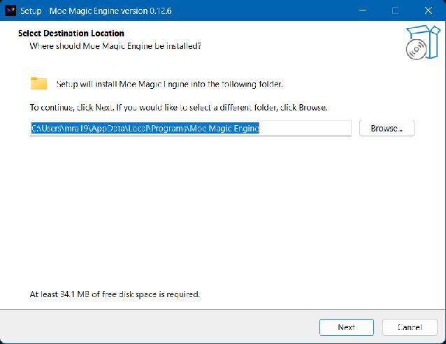
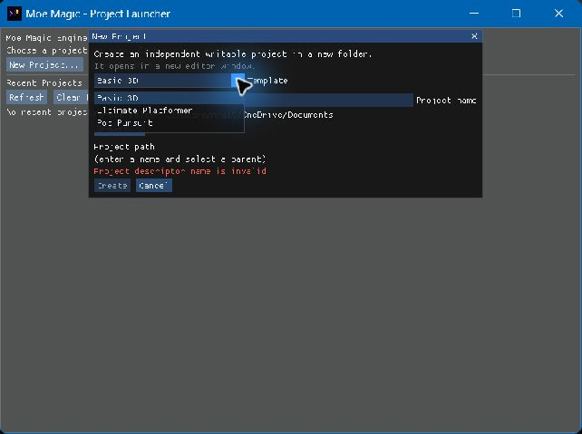
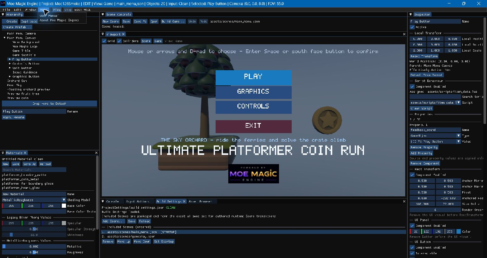

# Moe Magic Engine — Complete User Manual

**v2.0.0 edition; original tutorial reference content: v0.12.3.** For Windows game developers using Moe Magic for the first time. Historical screenshot/reference attributions remain explicit; installed acceptance is recorded separately.

## AI Designer Preview

Open **Window → AI Designer**. The optional OpenAI integration supports project/Scene/object
inspection, capability discovery, Project and Shared asset search/provenance, reviewed Add to
Project, consented script reading, planning and reviewed imported-Model assignment. Further editing
operations will be expanded in later updates. Full live multi-step authoring is not qualified.

1. Enter your API key in the masked field and click **Use session key**. Until then the entry is
   marked pending. Optionally **Remember in Windows vault** for this Windows user; recall is hidden
   and does not send a request. **Remove remembered key** deletes that one credential. Never paste
   a key into a task, project, report or chat. The vault does not protect against other programs
   running as the same Windows user.
2. Review the project/model and context categories. Script source and selected rendered images need
   separate consent. Choose the allowed output parent and **Grant and attach**; this is local, not
   a network request. Non-secret choices persist, but normal startup does not restore active consent.
3. Authorize a finite API allowance. API billing is separate from ChatGPT subscription billing;
   any eligible API credits are managed on your API account. Exact input-token counting (including
   tools) precedes reservation with a safety margin and the requested maximum output. Exposure is
   conservative, not confirmed money spent. Interrupted unknown usage is retained, not refunded.
4. Enter a small task and choose **Plan only**. Read the plan, then explicitly start one supported
   proposal. Use **Operation availability** to distinguish live Preview from the broader adapter.
   A read returns a native receipt; a change waits for exact review. Approve once or Deny. Manual
   changes can make a review stale. Nothing is executed merely because a plan or response says so.
5. **Stop** cancels pending work without discarding committed edits. **Revoke context / detach**
   closes only the Designer session. **Close allowance / expire unused authorization** permanently
   expires the unused balance, retaining receipts; it cannot renew or transfer that authorization.

Transform/property patches (including single-property patches), component edits, creation/removal,
non-Model resource assignments/clears, script writes, history/save, automated Play/capture and
publication are **not available through live OpenAI Preview in v2.0.0**. Unsupported selection is
rejected locally before provider dispatch. Use ordinary editor controls or the maintained structured
authoring adapter for those operations. The adapter exposes 61 complete descriptors/80 typed Editor
commands and native history, script/resource documents, bounded disposable input/step/capture and
Windows/Web builds. It is for agents/tools using the installed skill, not arbitrary Scene JSON,
shell commands or unrestricted filesystem editing. Designer and external stdio are exclusive owners.

Ordinary editing, Play and **Build Game** remain offline and independent of AI. No credential,
conversation or provider-only files enter a game package. OpenAI requests use `store=false`, which
is not a zero-retention guarantee; review the
[API data policy](https://developers.openai.com/api/docs/guides/your-data) and
[API credit guidance](https://developers.openai.com/api/docs/guides/chatgpt-api-credits).
There is no automatic retry, model fallback or spending refill. No new model qualification is
implied by selecting an advanced model. Simulation does not establish real browser permission,
physical controller or audible playback acceptance.

### Terrain: make a walkable pass

Open the Terrain tool from Assets. Create a 65×65 draft at one-metre spacing, name it under
`assets/terrain/` with the suffix `.terrain.json`, and save. Add Terrain to a single root
object, assign the file (and optionally an opaque Material), then enable the Component.
Translate the owner to place its first corner. Its rotation and scale must stay at identity;
do not add another Collider to supply ground.

In Scene view enable **Scene brush**. Set a radius and signed height delta; drag on the
surface and release to commit one stroke. Escape cancels. Use a straight ramp stamp for a
pass, or sample local XZ to see the actual triangular slope. Panel fields use centimetres;
agent operations use metres. **Undo terrain** restores this resource, not the Scene selection
or object history. Save the terrain and its Scene assignment, bake navigation, then save the
changed Scene reference. **Inspect navigation freshness** explains a stale or absent bake.
Terrain is static during Play. Windows and experimental Web export the saved resource, not
viewport previews. The v1.23 candidate offers Basic 3D, Ultimate Platformer and Cinder Relay.

### Paint a terrain road and review scenery

Open the Terrain panel and select the terrain resource. Add a road color after the base
palette slot. Create a named corridor with local XZ points and a half-width; preview and apply
a corridor paint stamp. A mask defines clearance but does not paint by itself. Sample both
banks, then **Save terrain**. Terrain Undo changes the draft, not your Scene or baked path.

Choose **Placement (Scene Undo)**, set a group key and bounds, and add project models or
scenery prefabs. Models are decoration. To place collision, choose a prefab with an explicit
Static body and solid collider and enable its solid option. Choose the masks, seed and target.
**Preview placements** lists additions, retirements, footprints and preserved member names
and reasons. Apply only after reviewing them. If a guide cannot pass, inspect the obstacles,
widen the clearance corridor, save the terrain, and preview **Replace**. An edited prop
should appear under preserved. Apply, use Scene Undo/Redo if needed, save the Scene, then
explicitly rebake and save the new navigation reference. Moving paint alone needs no rebake.

### Textured skies and section authoring (v1.15)

In Sky Environment, keep Gradient for the original background or assign a project PNG/JPEG below
`assets/images/` and select Equirectangular. Use a2:1 panorama up to4096x2048 (the sample uses2048x1024).
Yaw rotates the backdrop; background intensity controls its brightness. Lighting still comes from
the analytic gradient, so a photograph does not automatically relight objects. Return to Gradient
before clearing a required enabled image. Save/reopen and Build Game retain the image and declared notices.

Compose a section with existing Checkpoints, paths and optional objective routes. Keep a single
Navigation Surface and rebake after changing cover. For agent authoring, the installed skill now
exposes complete section descriptors, typed Material create/patch and request/inspect/cancel bake
commands. A stale Material digest rejects instead of overwriting edits. Do not edit Scene JSON.
See the Platformer companion for three-Gem states, attempt recovery versus durable saves and quiet music.

Moe Magic is a proprietary 3D game engine and editor. You assemble Scenes from GameObjects and Components, import supported assets, add project-local Lua logic, preview your game, and publish a standalone Windows Player. This manual explains that workflow without requiring knowledge of the engine's implementation history.

Use [Ultimate Platformer](ULTIMATE_PLATFORMER.md) as a practical companion. The [documentation index](README.md) states this edition's verification status.

## Table of contents

1. [Install, launch, and choose a project](#1-install-launch-and-choose-a-project)
2. [Understand your project](#2-understand-your-project)
3. [Find your way around the editor](#3-find-your-way-around-the-editor)
4. [GameObjects, hierarchy, and transforms](#4-gameobjects-hierarchy-and-transforms)
5. [Scenes, saving, recovery, and prefabs](#5-scenes-saving-recovery-and-prefabs)
6. [Assets and model importing](#6-assets-and-model-importing)
7. [Materials and textures](#7-materials-and-textures)
8. [Cameras, lights, and presentation](#8-cameras-lights-and-presentation)
9. [Physics and character gameplay](#9-physics-and-character-gameplay)
10. [Animation](#10-animation)
11. [Input and rebinding](#11-input-and-rebinding)
12. [Audio](#12-audio)
13. [Canvas, menus, and HUDs](#13-canvas-menus-and-huds)
14. [Particles and health](#14-particles-and-health)
15. [Lua scripting](#15-lua-scripting)
16. [Preview, pause, and debug](#16-preview-pause-and-debug)
17. [Build and distribute a game](#17-build-and-distribute-a-game)
18. [A maintainable game-development workflow](#18-a-maintainable-game-development-workflow)
19. [Troubleshooting](#19-troubleshooting)
20. [Component and capability reference](#20-component-and-capability-reference)

## 1. Install, launch, and choose a project

### Compose reusable boxes and collectible feedback (v1.14)

In a writable Ultimate Platformer copy, instantiate `orchard_ordinary`, `orchard_multi`,
`orchard_reward`, `orchard_bounce` or `orchard_tnt` from Assets/Prefabs. These are ordinary
GameObjects, not hard-coded game modes. Stack two independent roots with Dynamic Rigid Bodies;
do not parent a Dynamic crate beneath the supporting crate. The reward recipe references
`orchard_carrot_bundle`: three independent pickups under one30-second expiry container.

For a custom pad, add solid Collider + Rigid Body, then Bounce Surface; configure speed/top angle
and enable it. Remove/disable Stompable first: the same object cannot be both. For a timed box,
add Health + Destroy Breakable + solid Collider/Rigid Body and Timed Explosive. It starts Idle;
an API24 script explicitly arms it. Fuse/radius/masks and receiving chain delay are Inspector
settings. Do not use DestroyAfterTime to substitute for an explosion. Query remaining time for
warnings; native physics/Health own the blast and one terminal break.

For pickup feedback, add a UI Flight Emitter beneath the HUD Canvas, choose a resolved image,
and set Target to a visible Rect Transform under that same Canvas. Configure32px/0.55s/64px arc
as a starting point, then enable. The pickup queues Health/objective credit first and calls
`emit_ui_flight` with its current world point; unavailable presentation never prevents collection.
Keep optional emitter lookup separate from the required, uniquely named Character collector.
Save/reopen and Play; use Stop before editing. Existing Undo applies to document edits, not
external prefab-file publication. [The Platformer tutorial](ULTIMATE_PLATFORMER.md#retained-reusable-garden-mechanics)
describes the actual sample and its preserved health/progression rules.

### Compose interactions, projectiles and framing

In your own writable project, add **Interactor** to the player or another positive-uniform root.
Add a named Button action in Input Actions (for example Interact, E / gamepad Face West), and set
the Component's Action Name to match. Start with Range 2.5 and Origin Offset (0,1,0). New action
Components start disabled; configure their dependencies before enabling them.

Add **Interactable** to a lever, cache or other target. Set a short supported prompt, whether it
needs clear line of sight, a cooldown, and optional One Shot. It does not need its own Collider.
Native interaction selects the nearest eligible point and records activation; your Lua script
decides what that activation does. In API23, poll `get_interactable_status(target).activation_revision`
to open a gate or request a reward once. A Canvas-owned script can show
`get_interactor_status(player).prompt` while a target is focused. Do not hardcode a keyboard glyph
as if it were the current remapped binding. Holding the Button is not repeated activation.

For a shot, create an ordinary prefab with a unit-scale root and **Projectile**, plus an optional
scaled visual child. Do not add a Collider/Rigid Body/Character or another root motion controller.
Set full Box dimensions, Speed, Lifetime, Damage and masks. Give the firing object a **Prefab
Spawner** referencing that prefab. An API23 FixedUpdate/Update/LateUpdate script calls
`fire_projectile(spawner, instigator, {x,y,z}, {dx,dy,dz})`, then polls the existing spawn ticket.
Use nil for no instigator; a supplied instigator needs an enabled root Collider and is ignored by
its own shot. The direction is normalized, with local -Z forward. Ordinary Spawn Prefab is not a
projectile launch. A hit damages eligible Health once and retires the actor; expiry simply retires.
Keep authored source limits small. There is a shared maximum of 32 live/reserved projectiles.

For a wider side-area view, add **Camera Framing Zone** to a stationary root with an enabled Box
trigger and no Rigid Body. Assign the player's enabled Follow Camera. Adjust Distance, Height,
Look At Height and Blend Seconds; the selected Collider overlay shows the volume. The target point
selects the highest-priority overlapping zone, with a small Exit Margin to avoid border flicker.
Leaving restores the camera's authored framing. Heading, Orbit controls, movement basis and FOV
do not change. Use Play/Stop to compare; runtime blends never overwrite your authored values.

All four Components support ordinary Inspector/history/prefab workflows. Safe scalar/vector
prefab properties can be overridden by a single-base variant, but Camera references cannot.
Interactor, Interactable and framing zones are not runtime-spawnable actor types. Save your
project before building Windows or Web; referenced project assets and required notices travel
through the normal Build Game workflow. No compiler or external preview server is needed.

### Supported setup

The current editor and Player target **Windows x64** and **OpenGL 3.3 Core**. Use Windows 10/11 with a working graphics driver. Startup validates actual graphics capabilities, including required HDR/multisample support; an advertised OpenGL version alone is not a guarantee that a machine meets every requirement.

Obtain **MoeMagicEngine-1.13.0-Setup.exe** and its matching checksum from the owner-provided candidate,
or the [official releases](https://github.com/mra1991/MoeMagicEngine/releases) after acceptance,
read the wizard's [Free Proprietary License](../../LICENSE.txt), choose the application location
and optional Desktop shortcut, and finish installation. The default is your Local App Data Programs
folder; setup is per-user without administrator access. Launch **Moe Magic Engine** from its Start
Menu entry or optional shortcut. This release is unsigned. External clean-machine
verification remains owner-deferred to real users, not claimed as passed. See the guide index for
[Shared Library, licensing and Windows security](README.md#starter-asset-library).

The installation includes the editor, Player template, offline guide, Basic 3D and both sample sources. Keep game projects **outside** the installation. Use **Help > User Manual** for this offline guide. Ordinary authoring needs no Visual Studio, PowerShell or C++ build; contributors use the separate developer reference (see installed documentation/source reference). The complete portable payload retains the same project ownership rules.



*Genuine v0.12.6 developer-host capture. The wizard displayed the default destination;
the recorded smoke actually installed to a temporary directory. This is not clean-host
or default-destination installation evidence.*

### Launch behavior

Double-click `MoeMagicEngine.exe` to reopen the exact valid most-recent project. If that entry is unavailable, or history is empty/unusable, the Project Launcher appears. It does not silently choose another recent project or treat the current directory as a game.

Use the launcher's **New Project...** or **Open Project...**, or the same actions in the editor's **File** menu. Optional command-line selection belongs to the developer launch reference (see installed documentation/source reference); it is not required for the graphical workflow.

### Create a project

1. In the launcher, select **New Project...**. In an existing editor, use **File > New Project...**.
2. Choose **Basic 3D** or **Ultimate Platformer** in **Template**, then enter **Project name**. It also becomes the folder name, so use a valid Windows directory name.
3. Check the suggested Documents **Parent folder**, or choose another existing folder with **Browse...**. Redirected Documents locations are supported.
4. Check the displayed **Project path**, then click **Create**. The final folder must not already exist.
5. Your independent writable project opens in a new editor process. A sample retains its Scenes, assets, input and Build Settings; only the descriptor's display name changes.

Installed `Samples` folders are source templates, not workspaces. Create your own copy through New Project, then edit/open that copy. Another copy or reinstall never overwrites an existing game. Source-built and older portable editors without declared sample inventories show sample choices unavailable; source developers can Open the repository's ordinary Projects instead.



Pot Pursuit is retired from new installations and tutorials. Existing user projects still open;
upgrade cleanup preserves modified/unknown files and all external projects. The optional installed
`Authoring` skill/schema directory is for agent-host integration, not a required tool for this guide.

*Genuine v0.12.6 developer-host capture of the three Template choices. The empty-name
diagnostic shown is expected before entering a project name. Current content may differ.*

### Upgrade, reinstall and uninstall

Install a newer version into the existing application folder. The stable installer identity
normally remembers that folder and replaces the application, rather than creating versioned
side-by-side installs. Keep the same destination; do not redirect a normal upgrade to a temporary
test directory. Verify **Help > About** and Windows **Installed apps** report 1.13.0 and that your
Start Menu/Desktop shortcut launches that copy. If an old test install redirected registration,
select the original application folder explicitly during setup and recreate the Desktop shortcut.
Independent projects are not overwritten or automatically replaced with newer samples: use
**New Project > Ultimate Platformer** for a fresh current reference copy.

Close editor and Player windows first. Setup asks you to close hosts rather than force-terminating unsaved work. Reinstall replaces application inputs, not game copies or preferences. Windows' installed-apps list or Start Menu **Uninstall Moe Magic Engine** removes the application and shortcuts while preserving separately stored projects, layout and recent history. Keep backups; manually deleting a game folder is a separate action.

Basic 3D contains a Main Camera, Directional Light, Ground, and Cube, together with saved input and Build Settings. Its `assets/scenes/default_scene.json` is an ordinary starter Scene—not a special engine-wide default. The Ground is initially visual geometry; add a Collider and Static Rigid Body before expecting it to support physics.

### Open and reopen

Use **Open Project...** in the launcher or **File > Open Project...** in the editor, then select the project root. **File > Open Recent Project** provides recent entries. **Refresh** updates launcher availability; clearing recent history does not delete projects.

Opening another project starts another process. It does not replace the current project's dirty Scene. Close unused editor windows when you finish with them.

Within a chosen project, startup tries its first valid Recent Scene, then its saved Build Settings startup Scene, then an empty unsaved Scene with a diagnostic. This explains why reopening the editor may show gameplay even though a packaged game starts at its Main Menu.

## 2. Understand your project

```text
My Game/
├── ProjectSettings/
│   ├── project.json          Project identity/display name
│   └── build_settings.json   Included Scenes and startup Scene
├── assets/
│   ├── scenes/               Saved .json Scenes
│   ├── prefabs/              .prefab.json subtree templates
│   ├── models/               OBJ/glTF/FBX packages and their dependencies/notices
│   ├── materials/            .material.json reusable surfaces
│   ├── textures/             Material PNG/JPG/JPEG images
│   ├── images/               Canvas images, logos, HUD artwork
│   ├── audio/                Supported WAV clips and provenance
│   ├── scripts/              UTF-8 .lua sources
│   └── input/input_actions.json
└── Library/                  Generated local editor/recovery state
```

Moe Magic requires **project-local asset paths**. A stored identity such as `assets/scripts/player.lua` is resolved from the selected project, not the executable directory or a sibling project. Use forward slashes in authored identities. Spaces in contained paths are supported. Do not use absolute machine paths, `..` escapes, or links outside the project to supply runtime assets.

To move a game to another computer, copy its complete authored project, including `ProjectSettings`, assets, dependencies, and license notices. `Library` is generated workflow state, not the game. Personal layout and preferences are not a substitute for saved content.

There is no implicit shared asset lookup. The sample copies are the initial source collection: copy an asset with its MTL/textures or glTF dependencies, audio/image provenance and notices into your own game. Keep third-party CC0 notices; engine branding and proprietary scripts are not thereby CC0. Reusing assets never mounts a sibling project.

The [Project format](../PROJECT_FORMAT.md) describes the descriptor for tool authors. Most users should create projects through the editor instead of hand-writing strict metadata.

## 3. Find your way around the editor

### Readable editor text

**Edit > Preferences > Editor Text Size** offers **Compact (13)**, **Comfortable (16, default)**
and **Large (18)** logical pixels. The launcher offers the same preference. A selection applies on
the next frame, without restart or Scene edits. Compact retains the old smaller size.

This is separate from layout: `%LOCALAPPDATA%/MoeMagicEngine/Editor/preferences.json` stores the
closed text-size choice, while `imgui.ini` stores docking. Reset Layout does not reset text size.
Malformed, unwritable or externally changed preferences retain their bytes; a warning identifies
session-only choices. This setting does not resize authored Canvas text or Player UI.



*Genuine v0.12.6 developer-host capture of an independently created installed sample copy,
with Help > User Manual visible. It records rendered content and menu context, not a
v0.12.7 interaction test or a completed game. See the [guide evidence](README.md).*

### Workspace

| Area | Purpose |
| --- | --- |
| Hierarchy | Create, select, name, organize, duplicate, and delete GameObjects. |
| Inspector | Edit the selected object's Transform and Components. |
| Viewport | Scene navigation and editing, or the authored Camera's Game view. |
| Asset Browser | Find and assign models, prefabs, Materials, audio, and scripts. |
| Asset Dependencies | Diagnose saved references and missing/supporting assets. |
| Materials | Edit a reusable Material document. |
| Console | Read engine and script diagnostics. |
| Input Actions | Author the project's gameplay bindings. |
| Build Settings | Declare saved Scenes to include and choose startup. |
| Renderer Diagnostics | Inspect rendering status and select graphics quality. |
| Scene Controls | Scene operations and preview controls. |

Panels dock and resize. Reopen a closed panel through **Window**. First run and **Window > Reset Layout** use the shipped approved layout; customization saves separately in Windows Local App Data and survives updates. A damaged preference file is preserved until you explicitly reset. Layout never changes your Scene or the shipped seed. The editor launches as a maximized normal desktop window, not exclusive fullscreen. **Help > About Moe Magic Engine** shows the current version and developer identity.

### Scene view versus Game view

The **Scene** and **Game** buttons are in the Viewport. Scene view uses a free editor Camera and displays editing aids. Game view uses the Scene's authored primary Camera and shows Canvas presentation. Switching to Game view is not the same as starting simulation; a stopped Game view can show the authored composition without running gameplay.

Scene navigation acts on the **displayed image**, not every pixel in the editor. Click/focus that area before using keys. Text fields, dialogs, gizmos, and other controls can take input ownership.

| Scene-view control | Action |
| --- | --- |
| W / S | Move editor Camera forward / backward. |
| A / D | Move left / right. |
| Q / E | Move down / up. |
| Shift | Move faster. |
| Right mouse drag | Look around. |
| Middle mouse drag | Pan in the screen plane. |
| Alt + left mouse drag | Orbit a selection-derived pivot, or a forward fallback when needed. |
| Mouse wheel | Change field of view; this is not object scaling. |
| F | Frame the selected object's visible hierarchy from Scene view, Hierarchy, or a non-editing Inspector; text fields and modal controls keep their input. |
| Left click | Select the nearest active rendered triangle; empty space clears selection. |

Successful Play hands focus to the Viewport once: fresh gameplay input needs no image click. During Play, WASD is reserved for gameplay, not free-Camera translation. Game view does not accept editor Camera navigation. Scene view retains mouse navigation for inspection. Release keys/buttons after changing focus before acquiring input again.

Selecting a nested object reveals its ancestor path in Hierarchy once; later manual scrolling/collapse is respected. The passive XYZ widget in the Scene image's top-right follows Camera orientation (red X, green Y, blue Z). End-on `+` points toward you and `-` away. It does not appear in Game or Player and is not clickable.

**Grid** and **Colliders** are editor aids. The selected collider is shown even when the all-colliders toggle is off. These overlays do not appear in the final Player.

## 4. GameObjects, hierarchy, and transforms

### Create and configure an object

1. Choose **+ Create** in Hierarchy.
2. Select the new object and enter a useful **Name** in Inspector.
3. Use the **Add Component** area to give it a role. For visible geometry, add Mesh Renderer.
4. Edit **Local Position**, **Local Rotation**, and **Local Scale**.
5. Save the Scene when the result is useful.

Every GameObject always has one Transform. Optional Components add rendering, physics, behavior, audio, UI, or other capabilities. You combine those roles rather than create a different gameplay subclass for every object. The editor prevents duplicate Components of the same concrete type and disallows removals that would break required dependencies.

The object's **Active** checkbox affects it and its descendants. Each optional Component also has its own enabled state. Disabling a Mesh Renderer hides its rendering without automatically removing every other role on that object; disabling the entire GameObject is broader.

### Local and world space

An object's local Transform is relative to its parent. A root's local Transform is also its world Transform. Moving or rotating a parent moves its children; scaling a parent also scales child offsets and geometry.

Position uses world units. Rotation fields use **degrees**. Scale components cannot fall below **0.1**. Reset Transform restores local position/rotation to zero and local scale to one, not necessarily a child's world pose to the origin.

The local matrix is translation × Z rotation × Y rotation × X rotation × scale; scale and X rotation are applied first to a point. Usually you do not need to calculate matrices, but remember that Euler-axis rotations are order-dependent and nonuniformly scaled parents can complicate reparenting and physics.

### Gizmos and precise edits

Use the gizmo toolbar's **Move**, **Rotate**, or **Scale**, choose **Local/World** orientation where applicable, and enable operation-specific snapping when placing regular layouts. Drag the displayed handle for a spatial edit. Use Inspector numeric fields for exact placement; Ctrl-click or double-click an ImGui drag field to type a value and confirm it.

One continuous Inspector/gizmo drag is one Undo operation. **Ctrl+Z** undoes; **Ctrl+Y** or **Ctrl+Shift+Z** redoes. Use the toolbar rather than the obsolete T/R/S, axis-letter, arrow-adjustment, tint-cycle, or wireframe keyboard shortcuts from early engine versions.

### Organize the hierarchy

Drag an object onto another Hierarchy row to reparent it. Use **Drop Here to Detach** or Inspector **Detach From Parent** to return it to the root. Reparenting preserves world placement when the required transform decomposition is valid; a cycle, self-parenting, or an unsafe transform fails instead of corrupting the hierarchy.

Use empty group objects such as `Environment`, `Gameplay`, and `Audio` to make a Scene readable. Keep organizational groups at identity Transform unless their motion/scale is intentional. Physics-driven roots have stricter rules in [Physics](#9-physics-and-character-gameplay).

**Duplicate** copies the selected subtree, including authored Components and references that can be remapped. Geometry and Materials can remain shared while each object has its own Transform and tint. **Delete** removes the selected object and all descendants; Undo restores the subtree. Names need not be unique, so prefer explicit script object properties over ambiguous name lookup.

## 5. Scenes, saving, recovery, and prefabs

### Scene files

Use **File > New Scene**, **Open...**, **Save**, and **Save As...**. Shortcuts are Ctrl+N, Ctrl+O, Ctrl+S, and Ctrl+Shift+S. New Scene creates an empty Untitled Scene; it does not recreate Basic 3D's objects. Scene files must be `.json` beneath the current project's `assets/scenes` directory. Saving an Untitled Scene asks for a path; it does not overwrite a default Scene automatically.

Before New/Open/Exit discards dirty work, the editor offers Save, Discard, or Cancel. Saving must succeed before the requested transition completes. Scene, Input Actions, Build Settings, and Material drafts have distinct saving responsibilities; resolve every dirty resource the editor reports.

Use **File > Open Recent** for the project's recent Scene list. This is separate from **Open Recent Project**. Recent Scene selection affects editor reopening, not packaged startup. Build Settings remains the saved declaration for the game.

### Recovery is not Save

Dirty Scene edits may be captured in an ignored recovery record after about five quiet seconds, or about thirty seconds of continuous editing at a safe Edit-mode point. Startup presents **Restore**, **Discard**, or **Exit** when recovery requires a decision.

Restore recovers a dirty draft; save it explicitly. If the original Scene changed or cannot be verified, recovery may restore as Untitled and require Save As. Input Actions and Build Settings have their own recovery decisions. Recovery is not version control, does not merge competing edits, and does not silently overwrite authored files.

### Prefabs: reusable independent copies

1. Build and select a useful subtree.
2. Choose **Create Prefab...** in Hierarchy.
3. Save beneath `assets/prefabs` with the full `.prefab.json` suffix.
4. Refresh the Asset Browser if needed and find the prefab.
5. Double-click it to instantiate an **independent copy** at the Scene root.

Instantiation is undoable and selects the new root. Saving the prefab itself writes an asset; it is not a Scene-history operation.

Ordinary prefab instances are independent copies, not live linked instances: source edits do not
propagate to placed objects, and there is no Scene-instance Apply/Revert or nested linked-prefab
system. **Single-base prefab variants** are supported as separate assets with typed overrides and
explicit Refresh Base; see the saved-progress/variant workflow below. Script GameObject properties
captured inside a prefab must refer to that subtree or None. An outside Scene reference is rejected,
not silently removed. Clear an external player property before capture and assign it after instantiation.

## 6. Assets and model importing

### Bring an asset into a project

1. Copy the supported source and all required supporting files into the appropriate project asset directory using normal file tools.
2. Preserve the asset's license/provenance and relative dependency layout.
3. In Asset Browser, use **Refresh**, then search by filename, folder, or project-relative path.
4. Select a GameObject with Mesh Renderer. In Inspector, choose the imported-model **Source**, select the model or enter **Model Path**, and use the displayed Load action.
5. Inspect the result and Console. Add collision geometry separately if needed.

Importing a model does not automatically create colliders, a Character Controller, a gameplay Camera, or scripts. A multi-section imported Model uses one GameObject Transform with its section Materials. Duplicating the renderer can reuse loaded geometry.

### Supported formats

| Source | Current support and preparation |
| --- | --- |
| OBJ + MTL | Static geometry; imported sections and supported diffuse material/PNG/JPG texture data. Keep OBJ, MTL, and images together in their expected relative structure. |
| JSON glTF `.gltf` | A strict static subset and bounded single-skin skeletal animation. Keep referenced buffers/images inside the permitted project asset structure. |
| FBX `.fbx` | Bounded static geometry or v1.7 linear skeletal skinning/baked TRS clips; see Animation for limits. Preserve required relative textures/notices. |
| `.glb` | Not a supported import path. Merely renaming the extension does not convert it. |
| glTF morph targets or unsupported extensions/effects | Not a supported workaround for skeletal animation; unsupported models can be rejected as a whole. |
| Procedural geometry | Cube, Plane, UV Sphere, Cylinder, Cone; no external model file needed. |

For glTF, use triangle geometry and the supported base-color/scalar metallic-roughness material features. Animated input needs the supported one-skin setup, valid joints/weights, named clips, and LINEAR translation/rotation/scale tracks. Do not assume an arbitrary exporter preset is fully supported. Normal/occlusion/metallic-roughness/emissive maps, morph animation, root-motion extraction, and general glTF effect support are not part of the current subset.

If an import fails, reduce the export to the supported subset or choose a known-compatible source. Read the actual diagnostic rather than repeatedly loading a malformed asset. A failed replacement preserves the previous valid resource.

### Procedural meshes

Choose Procedural as Mesh Renderer Source, then a **Primitive** and its parameters. Size/radius/height control generated geometry; Transform scale controls the instance. Plane width/depth and subdivisions, sphere rings/segments, and cylinder/cone segments/caps let you balance shape and complexity. **Reset Primitive Parameters** resets the selected recipe.

Procedural primitives have neutral base vertex colors. Mesh Renderer tint and Materials provide visible color; changing tint does not regenerate the mesh. Shape parameter changes do create a different geometry recipe.

### Refresh, reload, and dependencies

**Refresh** discovers/catalogues files. It is not the same as successfully replacing a loaded resource. Explicit Model/Material reload performs a validated replacement, and **Asset Dependencies** explains what references an asset and what it needs.

Referenced models, reusable Materials, their supported dependencies, Canvas images, and AudioClips support editor **Auto Reload**. It is enabled by default for the session and waits for file writes to settle (approximately 750 ms). Unsafe states such as Play, a dialog, or a continuous edit defer changes. A malformed replacement keeps the prior usable state and exposes a diagnostic; correct the file and retry when appropriate.

Auto Reload is not Lua hot reload, Scene merge, or prefab propagation. New catalog content may still require explicit Refresh. A catalogued but uninspected model is not proof of a valid import, license, or package closure.

## 7. Materials and textures

### Make and assign a reusable Material

1. Open **Window > Materials** and choose **New**.
2. Set **Name**, **Shading Model**, and surface values.
3. Use **Save As** to create `assets/materials/name.material.json`.
4. Select an object's Mesh Renderer, choose the saved Material, and click **Assign Material**.
5. Use **Open in Materials** to edit it later. **Remove Material** removes the override and reveals the model's original section Materials.

A renderer override applies to **all sections** of that renderer. It is not a per-section material-slot editor. Editing the shared Material affects stopped-Scene renderers that refer to that identity after successful publication; tint and wireframe remain per-object settings. Scene Undo records assigning an asset, not arbitrary edits to that asset's file.

| Setting | Meaning |
| --- | --- |
| Base Color | Overall surface color, multiplied by relevant texture/vertex color and renderer tint. |
| Base Color Texture | Optional project-relative PNG/JPG/JPEG beneath `assets/textures`. |
| MetallicRoughness | PBR-style surface; Metallic 0 is dielectric, 1 metallic. Roughness controls highlight breadth. |
| LegacyBlinnPhong | Compatibility shading with Specular, Specular Strength, and Shininess. |
| Emissive Color / Intensity | Adds visible radiance independently of lighting; intensity 0 disables emission. It does not light nearby objects. |
| Opaque | Solid surface; stored Opacity is ignored. |
| AlphaBlend / Opacity | Scalar transparent surface; opacity 0–1. It does not cast the Directional shadow. |

New Materials default to white MetallicRoughness, metallic 0, roughness 0.5, no emission, Opaque, opacity 1. Inactive shading-model fields remain stored so switching models does not discard their tuning.

Use a modest emissive intensity for collectibles; heavy glow can obscure shape. Bloom depends on the selected graphics preset. Transparency sorting is by section depth, not a solution for every intersecting transparent mesh. Texture alpha is not a general glTF alpha-material workflow. Opacity does not change collision, picking, or gameplay.

Material **Save**, **Save As**, and **Reload** are explicit. Resolve dirty/conflicted Material drafts before Play or Build Game. If another program changed the source, the editor protects the dirty draft instead of blindly overwriting it. See [Material format](../MATERIAL_FORMAT.md) for exact serialization and limits.

## 8. Cameras, lights, and presentation

### Author a game Camera

1. Create a GameObject and add **Camera Component**.
2. Position/rotate it toward the subject. Moe uses +Y up and local -Z forward.
3. Enable **Primary**, then set **Field of View**, **Near Plane**, and **Far Plane**.
4. Switch the Viewport to **Game** to evaluate the composition.
5. If spatial sound is used, add an **Audio Listener** to the intended listener object, usually this Camera.

The primary Camera's pose comes from its world Transform, not the editor navigation Camera. Perspective projection uses the rendered image's aspect ratio. There is no orthographic Camera authoring in this release. Avoid an unnecessarily tiny near plane or enormous far plane; choose a range that covers your game.

A standalone Scene must have **exactly one enabled, effectively active primary Camera**. Editor Play can fall back to Scene view when a Camera is unavailable, but Player requires a valid primary Camera and reports missing/ambiguous/lost Camera state as an error. Multiple primary flags are not a camera-switching strategy.

### Read the Camera gizmo

Select a Camera in Scene view to see its direction and perspective frustum. Primary is green, non-primary blue, and disabled/inactive gray. Dashed amber far edges mean the visual guide was shortened; the far display extends at most ten units beyond the near plane. It does **not** mean the Camera renders only ten units.

Use this guide to judge direction and near framing, then verify the actual image in Game view. The gizmo is not an additional preview Camera, picking target, or runtime feature.

### Light a Scene

Add **Light**, choose its **Type**, set color/intensity, and enable lighting. Rotate Directional/Spot owners to aim them; move Point/Spot owners to position them.

| Type | Use and limits |
| --- | --- |
| Directional | Sun-like direction; position is irrelevant. The lowest-ID eligible Directional contributes. Includes Ambient Strength and Cast Shadows. |
| Point | Local illumination with bounded Range. |
| Spot | Local cone; Range plus Inner/Outer Cone expressed as full angles in degrees. Inner cannot exceed outer. |

A Scene supports at most eight contributing Point/Spot lights. Do not add several Directionals expecting all their light to accumulate. Only the primary contributing Directional can cast shadows; Point/Spot shadow maps are not supported.

For shadows, enable **Cast Shadows**, use an appropriate quality preset, and check the rendered Camera range/composition. Editor geometry and diagnostics help explain missing shadows; adding more lights is not a substitute for enabling the correct shadow path.

### Sky, HDR, and quality

Add **Sky Environment** to one object. Set **Zenith**, **Horizon**, and **Ground** colors, **Background Intensity**, and **PBR Lighting Intensity**. Only one Sky Environment may exist in a Scene, including disabled ones. Its Transform is not a sun direction. It provides a procedural background and bounded environment response, not an HDRI importer or reflection-probe system.

World rendering uses HDR, tone mapping, and display conversion. Exposure/tone-map tuning is not an authored post-processing stack in this release. Canvas and editor UI remain outside world bloom.

Open **Window > Renderer Diagnostics**, select a **Preset**, and **Apply**. The runtime **Graphics** overlay exposes the corresponding player-facing choice through an authored launcher Button.

| Preset | World samples | Directional shadows | Bloom |
| --- | --- | --- | --- |
| Performance | 1 | Off | Off |
| Balanced | 2 | On | On |
| Quality | 4 | On | On |

Quality is the default. A failed resource transition retains the last working setting. Player graphics preferences are local user state, not Scene content; do not distribute your personal settings as part of the game. Diagnostics report the current complete frame and resource status, not a general CPU/GPU profiler.

## 9. Physics and character gameplay

### Collider and body are different

A **Collider** describes a shape. A **Rigid Body** makes that shape participate in response physics. A nontrigger collider without an enabled body is query-only; it is not automatically a solid floor.

1. Add **Collider** and choose **Box**, **Sphere**, or **Capsule**.
2. Adjust **Center** relative to the owner and its shape dimensions.
3. For solid response, add **Rigid Body** and select a motion type.
4. Enable the Viewport **Colliders** overlay and compare the shape with the model.
5. Enter Play to test actual support, contact, and motion.

Box size is its full local size. Capsule **Total Height** is tip-to-tip and must exceed its diameter; the capsule's local long axis is Y. Sphere and Capsule require uniform positive world scale. Box supports positive nonuniform scaling. Visible models do not supply mesh colliders.

| Motion Type | Intended authoring |
| --- | --- |
| Static | Floors, walls, ramps, and other immovable response surfaces. |
| Dynamic | Gravity/solver-driven boxes, balls, and props. Set Mass, Gravity Factor, Friction, Restitution. |
| Kinematic | A deliberately driven platform or obstacle; physics receives a target and supplies carrying/pushing motion. |

Dynamic and Kinematic body owners must be Scene roots. Give them child visuals if convenient. Do not also animate their Transform through an ordinary Lua setter, Mover, or Rotator. Competing motion authority fails Play rather than producing a reliable hybrid.

### Triggers and filtering

Enable **Is Trigger** for a sensor. It detects overlap without being a solid obstacle. Each collider has Layer 0–15 and a 16-bit Mask; both masks must permit the other layer. Start with the default all-layer mask while learning, then narrow it deliberately.

Trigger Enter/Stay/Exit and response Collision Enter/Stay/Exit are distinct. A trigger does not produce a response collision event. Use triggers for pickups and hazard regions. Collision callbacks follow fixed physics steps; trigger detection follows the variable update before LateUpdate. See [Lua events](#physics-events-and-queries) before deciding where to put game rules.

### Build a controllable character

1. Create an upright **root** object at unit scale.
2. Add an enabled, nontrigger **Capsule Collider**.
3. Add **Character Controller**. Do not also add Rigid Body.
4. Add **Character Motor Behaviour** to consume Move, Turn, and Jump input.
5. Add a child visual model and align its feet with the capsule bottom.
6. Add solid Static floors and test in Play.

| Controller setting | Practical role |
| --- | --- |
| Mass / Maximum Push Strength | How the character interacts with Dynamic props. |
| Gravity Factor | Scales gravity; not an arbitrary gravity direction. |
| Maximum Slope Angle | Which surfaces are walkable. |
| Maximum Step Height | Small rises the character can traverse without a jump. |
| Floor Stick Distance | Helps maintain contact across small downward changes. |
| Motor Move / Turn / Jump Speed | Movement speed, degrees per second, and jump launch speed. |
| Movement Basis | Legacy preserves old behavior; World uses fixed Movement Yaw; Follow Camera reads its selected native Camera heading. |
| Movement Camera | An Orbit, FixedHeading or PathGuided Follow Camera targeting this Character; unused for Legacy/World. |
| Camera-relative movement | Retained Legacy-only checkbox; it does not control the new movement bases. |

Sky Orchard selects **Follow Camera** movement basis and its native Orbit Camera; Turn has one heading owner. The v1.16 Boulder Run candidate uses **Follow Camera** with **PathGuided**, heading offset 180, facing the player. **S/down-stick escapes toward the Camera; W/up moves away; A/D remain screen-left/right through bends.** Bindings are not inverted. Legacy remains available for existing projects.

Characters slide against walls, respect slopes/steps, ride Kinematic surfaces, and can push Dynamic props within the configured strength. They do not block one another as ordinary rigid bodies. v1.9 adds the bounded mechanisms and terminal ragdolls described below. High-speed collision, arbitrary controller shapes and general force/velocity scripting remain outside the current user API.

### Moving platforms

For a simple constant velocity, **Kinematic Motion Behaviour** remains available. For a bounded route,
add **Path Follower** to a unit-scale root with a solid Collider and Kinematic Rigid Body. Enter
2–32 inline points: first (0,0,0), then local offsets from the starting frame. Choose Once, Loop
(with a real closing segment) or PingPong; set Speed and Play On Start. The selected path appears
in stopped Scene view, never Game/Player. Inspector point edits and reordering use normal Undo.

Do not attach another motion writer to this root. Nonphysical decorative paths are also supported.
Pause holds the pose; reverse changes direction without teleporting. API 16 exposes explicit safe
reset, which may report blocked and requires deliberate retry. It never silently moves a rider
or searches for a safe alternative. Existing API-12 scripted Kinematic routes remain supported.

Keep the collider on the moving root and the mesh as an aligned child. The player rides through physics; parenting the player to a ferry is not required. Test boarding, edges, reversal, and dismounting. A decorative mesh moving through a normal Transform setter is not equivalent to a Kinematic platform.

### Native Follow Camera

Create a unit-scale root with an enabled Camera, mark it Primary when appropriate, and add
**Follow Camera**. Assign Target using the ordinary object selector. Choose Orbit (Turn input),
Trailing (target yaw plus heading offset), FixedHeading or PathGuided. Tune Distance, Height, Look At Height,
Turn Speed and Position Half-Life. Half-life zero snaps; a small positive value smooths position,
not movement direction. Startup and checkpoint recovery snap to the current desired framing.

Do not retain an orbit/follow Script on this same Camera. Follow Camera cannot target another
Follow Camera, itself or an invalid pose. FollowCamera movement basis permits Orbit/FixedHeading/PathGuided,
not Trailing feedback. Deleting a referenced object repairs the reference to None; Undo restores it.
Save/reopen and ordinary prefabs preserve authored values, never live heading/path state.

**PathGuided** requires an enabled, open Path Follower with usable horizontal tangents. Assign
Path Source, Path Look Ahead Distance (default 6 m) and Path Heading Half-Life (default 0.15 s).
The target projects onto the initially captured world route; lookahead determines heading before
the Character motor runs. Position smoothing moves one shared eye/aim anchor, not a second heading.
Turn input does not steer this mode. Recovery/snap resets framing; an unavailable route holds the
last camera pose and blocks that movement basis rather than inventing a direction.

### Rolling visuals and chase composition

On a unit-scale Path Follower root, add **Rolling Visual**, assign a centred direct-child mesh,
set the physical radius (0.01–100 m), then enable it. Keep the child's positive scale uniform and
remove competing transform scripts/animation/physics. The root remains the physical authority;
the child rolls from committed displacement and restores its authored orientation after an
acknowledged reset. Pause, failed motion and blocked resets do not create phantom rotation.
Use a UVSphere for textured rocks; imported models without UVs do not acquire UVs from a Material.

API25 `get_path_sample` / `project_onto_path` return copied captured-route metres/tangents, with
availability/reason. Project Lua owns refuge/arm/stop markers, grace, Health precedence and finish.
Wait for the queued reset revision and an alive player's actual recovered pose before rearming;
checkpoint identity alone is insufficient when recovery falls back to the start. A blocked reset
stays disarmed until explicit recovery/restart. Object inspection supplies static/authored model
and conservative collider bounds for grounding; neither is a current deformed/contact proof.
The optional authoring command `play.motion.inspect` copies 1–8 current Edit targets from the
originating Play generation only. It cannot mutate runtime state or inject gameplay input.

## 10. Animation

### Configure an animated model

1. Load a supported rigged `.gltf` or skeletal `.fbx` through Mesh Renderer.
2. Add **Animator** to that same object.
3. Select a valid named clip from the available clip list.
4. Set **Play On Start**, **Loop**, and **Playback Speed**.
5. Enter Play; a stopped editor does not run the animation timeline.

Clip names are case-sensitive. An Animator requires a compatible loaded rigged model; replacing it with an unrelated static model is not a safe way to retain old clip settings. A nonlooping clip reaches Completed and holds its terminal pose. Stopping playback returns the reference pose.

### Character animation

Add **Character Animation Behaviour** to the Character Motor owner, with exactly one direct child carrying the appropriate Animator. Set **Grounded Idle Clip**, **Grounded Move Clip**, **Airborne Clip**, optional **Jump Takeoff Clip**, and optional **Landing Clip**. Tune movement threshold and transition duration.

Ultimate uses `Idle`, `Run`, `Jump_Idle`, `Jump`, `Jump_Land`, and a 0.15-second transition. Native character motion determines accepted jumps and landings; animation does not drive the capsule through root motion. A rejected midair jump press should not start a new takeoff event.

Lua can request Play/CrossFade/Stop and read committed clip/status in Update/LateUpdate when the
Animator is not owned by Character Animation or an enabled state controller. There is no graph
editor, blend tree, timeline editor, full-body IK, additive layer, morph animation, retargeting or
seek API. Bounded LookAt and TwoBoneIK are available through Animation Constraint (see below).
Use [Lua animation](#audio-animation-and-ui-from-lua) for direct playback.

### Author a small Animation State Controller

In your writable project, use **Asset Browser > Shared Library** to find **Worker Male** and inspect
the four-influence derivative's source/license. Add it to Project, then assign that copied FBX to
a Mesh Renderer. Rig inspection shows joint identities, clip names/durations and a bind signature;
the signature is diagnostic, not permission to share animations between unrelated rigs.

Add Animator, then **Animation State Controller** on the same object. In the Inspector add named
states, select their exact clip names and Loop options, and choose Default State. Define Bool,
Number or Trigger parameters. Add transitions between different existing states; their list order
is priority. Choose the matching condition, value and 0–10 second crossfade. Clip Completed works
only from a nonlooping source. Use the list move/remove controls; Undo/Redo restores definitions.
Remove the controller before removing its required Animator. Missing choices can be saved as an
Edit draft, but an enabled playable controller must be complete. Save/reopen preserves authored
settings, not live parameters, clocks or events. Duplicate and ordinary prefabs copy settings.
Runtime-spawnable actor prefabs cannot contain this controller, even disabled.

For a greeting, add a `hello` marker at normalized time 0.35 in a nonlooping Greet state. An API-18
Script writes parameters/triggers and reads copied committed events in Update/LateUpdate. Consume
each event sequence only once; reading does not drain it. Markers suit audio/particles, not damage
or collision authority. See [the five API-18 operations](../SCRIPTING_API.md) and the shipped
`workshop_attendant.lua`. The controller owns playback; legacy Animator clip/loop/start controls
are inactive while it owns the Animator. Playback Speed remains supported. Do not also assign
that Animator to Character Animation or direct Lua Play/CrossFade/Stop.

Supported skeletal FBX uses linear skinning, one compatible rig, at most 32 joints/four influences
per vertex and bounded baked named clips. A clipless valid rig can render at rest without Animator.
Unsupported weights, morphs, dual-quaternion skinning, incompatible skins or sheared/singular bind
transforms reject explicitly. The sample derivative was converted offline with recorded provenance;
Moe Magic never silently trims arbitrary imported weights. Keep originals and validate deformation
after any deliberate external conversion. No new importer preference or runtime conversion is needed.

## 11. Input and rebinding

### Author Input Actions

Open **Window > Input Actions**. This edits `assets/input/input_actions.json`, separately from your Scene.

1. Add an action with a unique case-sensitive name.
2. Choose **Button**, **Axis1D**, or **Axis2D**.
3. Add digital bindings or compatible analog gamepad bindings.
4. Save before Play or Build Game. Resolve any validation/conflict message rather than leaving an invalid draft.

| Action type | Script use | Example |
| --- | --- | --- |
| Button | Held, pressed, and released Boolean state | Jump from Space / Face South. |
| Axis1D | One signed/scalar value | Turn from Left/Right or RightX. |
| Axis2D | Two numeric values | Move from WASD or LeftStick. |

The sample map has **Move** (WASD/LeftStick), **Turn** (Left/Right/RightX), and **Jump** (Space/FaceSouth). Gamepad axes use a default dead zone of 0.20. Button/stick labels refer to standard mapped positions, not vendor-specific names. One active standard-mapped gamepad is used; this is not a local multiplayer device-assignment system.

Keyboard, Mouse buttons 1–8, standard gamepad buttons, scalar axes, and whole sticks are supported as documented binding types. Raw mouse motion/wheel are not exposed as arbitrary Input Actions in the released map. Escape is reserved for host/UI cancellation and exit.

Actions allow 1–8 bindings and a project 1–64 actions. Type/name changes can break scripts and native motors expecting `Move`, `Turn`, and `Jump`; keep those contracts aligned.

### Focus and player preferences

In the editor, focus a running **Game** image to supply gameplay input. Text editing, dialogs, lost application focus, minimization, and ownership changes can neutralize it. Release held keys or return a stick to neutral after focus changes. The first click may establish focus rather than perform a gameplay mouse action.

An authored Button with **Input Preferences Launcher** opens the Controls overlay. It changes existing source slots through Rebind, Reset Selected, Reset All, and Close; it does not add actions or change their types/dead zones. Rebinding waits for neutral controls before capturing a replacement. Escape cancels capture or closes the overlay.

Controls settings persist as local user preferences, separate from authored Input Actions and the package. While the overlay is open, gameplay input is neutral but simulation can continue. It is not an automatic game pause. UI claims its owned controls; do not assume every key is globally disabled merely because one Canvas Button has focus.

### First-person control and rifles (v1.21)

Use one primary perspective Camera with **First Person View**, bound to an active capsule
Character. Set that Character Motor's movement basis to **FirstPerson** and bind the same
Camera. Eye Offset is measured from the Character origin, not its feet. Keep Follow Camera and
other camera writers off this Camera. The normal motor still owns movement and jump; strafe
and backpedal do not turn the body toward travel.

Save a `Look` Axis2D action with RightStick, `Fire` Button with left mouse/RightBumper, and
`Reload` Button with R/FaceWest. Relative mouse motion is supplied by the host, not an arbitrary
input binding. Click the running Game image to acquire look; release the activation button
before firing. Escape first releases capture without quitting. Click again to resume. Blur,
Stop and overlays release control; return held buttons/sticks to neutral before resuming.
Use standalone Chrome or a hosting frame that permits pointer lock for Web. If the prompt
persists, do not assume focus means capture. Escape remains an exit from the attempted interaction;
open the published URL in a standalone browser. The Codex embedded tab was not a passing FPS
input surface in the implementation proof. Non-FPS controls and Escape remain unchanged.

Add a disabled **Firearm** draft, then assign its instigator, Camera, neutral muzzle child and
optional visual child. Keep the primitive visual free of physics and other pose writers.
Configure the draft before enabling it. The muzzle is the physical origin; visual kick never
moves that logical origin. Begin with Semi, six rounds, zero spread and modest recoil. A shot
can hit cover beside the muzzle even when the centre of the screen sees the target. Clear the
firing position instead of weakening the rock's collision. Misses and cover hits still consume
one round; reload refills on completion. Camera recoil returns around the latest base aim rather
than erasing new mouse input. Stop resets ammo and transient state.

Optional Audio Sources/Particle Bursts provide cues; they do not control damage. Native Health
receives a hit once. Lua API27 can read `get_firearm_status` for an ammo/status HUD; a Scripted
firearm accepts bounded `request_fire`/`request_reload` intents, not caller-supplied damage/hits.
For external authoring, revision9's `play.combat.inspect` copies eye aim, actual blocker, ammo,
accepted damage and separate base/recoil values. Save/reopen and verify prefab internal remaps;
bind external Character/Camera references explicitly after instantiation.

The v1.23 Cinder Relay candidate develops the former repository-only drill into the Outpost
mission and third template. See [Cinder Relay](CINDER_RELAY.md) for its ordered relays, safe
recovery and three sentries; independent installed/owner acceptance is recorded separately.

### Ranged enemies and hit reactions (v1.22)

Start with one Scene-root solid Kinematic actor, Nav Agent, Perception, Agent State Controller,
Health and a **Scripted** Firearm. Add **Ranged Combat** disabled, bind that firearm, then tune
minimum/preferred/maximum range, aim settling time, accepted shots per burst, pause and bounded
reposition points. Navigation still owns motion/yaw and the Firearm still owns shot acceptance;
do not also fire/reload that weapon from Lua. Physical cover blocks the muzzle, even when the
target is visible. Perception's optional Navigation Target Offset lets one captured target
sample supply a torso aim point and a supported ground goal; None retains legacy single-point use.

**Hit Reaction** binds an optional visual/trigger and feedback palette, with reaction and cooldown
durations. It responds to accepted Health damage, not merely a shot request, and suspends living
combat briefly. Give the hit transition priority over locomotion/shot presentation. Lethal damage
supersedes the living response. Configure **Ragdoll** with the actual rig signature, qualified
bone paths, dimensions and part tree; optional Terminal Impulse acts once on its named part
(empty selects root), only when real incoming geometry exists. Zero keeps legacy behavior.
The retained corpse rests on Static geometry/Terrain, cannot damage or block gameplay and expires
at its configured lifetime. Stop/replay rebuilds authored state; there is no revival command.

API28 `get_ranged_combat_status` and `get_hit_reaction_status`, and revision10's copied
`play.combat.inspect`, expose observation/LOS, aim/timers and accepted-hit/terminal facts without
moving or firing anything. Missing/inactive/retired gameplay targets return nil in these Lua
queries. Capture a reusable configured sentry with internal refs; bind the new Scene's player
and navigation surface explicitly after instantiation. Do not retain duplicate disabled corpse
drafts in the Scene because they still count toward reserved capacity.

For a small mission, use New Scene, add a primary Camera and Canvas, and Save As an entry Scene.
Declare it and the encounter in Build Settings, choose startup and Save that separate document.
Use ordinary project Lua/Canvas actions for Start, Replay and Return. The external authoring
client exposes the same New/dirty-decision and guarded Build Settings edit/save/reload operations;
it cannot overwrite a conflicting draft or publish unsaved declarations. Closing the Player
window/browser tab remains a normal quit path. Cinder's native Quit button closes the Windows
Player; Web Quit stops the game and asks for reload without closing the browser tab.

Revision11 exposes Panel, Controls/Graphics launchers and Quit through the existing typed
authoring/history path (59 complete descriptors, 73 commands). A launcher/Quit marker requires
an eligible same-object Button; the owning Canvas Script handles project navigation only.
Use `scene.save_as` with an optional validated `displayName` for intentional published Scene
names. No new Scene/prefab format or runtime menu authority is introduced.

## 12. Audio

### Prepare a clip

Use a complete decodable **RIFF/WAVE `.wav`** beneath `assets/audio`. Supported decoded shape is mono/stereo, 8–192 kHz, duration greater than zero and at most 600 seconds. Encoded size is limited to 64 MiB and decoded float PCM to 256 MiB. A normal mono/stereo PCM WAV export is a practical starting point.

OGG/MP3 files retained in a source library are not runtime audio support. Export a suitable WAV in an external audio tool and keep provenance. Do not rename compressed files to `.wav`.

### Audio Source and Listener

1. Copy the WAV into the project and Refresh assets.
2. Select its catalog entry as needed, then add/configure **Audio Source** on a GameObject.
3. Choose **AudioClip**, **Play On Start**, **Loop**, **Volume**, **Pitch**, and **Spatial Mode**.
4. For **Spatial3D**, set **Min / Max Distance** and add one enabled, effectively active **Audio Listener**, normally on the Camera.
5. Play and listen at representative distances.

Two-dimensional sound ignores source position; use it for HUD cues and a constant player-local layer. Spatial3D uses source/listener world poses and linear-clamped distance attenuation; use a mono source for a clear localized emitter. A Camera does not automatically become a listener merely because it is Primary.

Moving a spatial source changes its audible position. Rotating/scaling a visual is not a substitute for distance tuning. There is no audio-mixer bus editor, streaming system, recording, Doppler, occlusion, or reverb-authoring workflow in this release.

Lua **play_audio** restarts the source-bound voice. **play_audio_one_shot** creates a nonlooping snapshot that may overlap and can finish after the source is destroyed. **stop_audio** stops both that source's main voice and its detached one-shots. All use the authored source settings; Lua does not choose arbitrary clip paths or edit volume/pitch at runtime.

An **Audio Button** is a simple same-object Button/Audio Source bridge. For shared hover/focus/cancel feedback, prefer the Canvas script mechanism in [UI](#shared-ui-feedback). Stop ends runtime audio. Missing audio hardware can warn and run silently; missing/invalid authored audio is a content error.

## 13. Canvas, menus, and HUDs

### Compose screen-space UI

A **Canvas** establishes a reference resolution and render order. Descendant **Rect Transform** Components resolve screen rectangles; **UI Panel**, **UI Text**, and **UI Image** provide visuals. The ordinary 3D Transform is not the screen-layout editor.

1. Create a root with Canvas; 1280×720 is the sample reference resolution.
2. Create a child, add Rect Transform, then add one visual.
3. Set anchors, pivot, anchored position, size delta, and render order.
4. Switch to Game view to evaluate placement at the actual image size.

Coordinates are top-left-origin, Y-down. Anchors are normalized within the nearest parent rectangle (or Canvas); pivot chooses the point used for placement. With equal anchors, Size Delta defines the rectangle size. Different min/max anchors stretch it across part of the parent, with offsets. For a centered fixed card, use both anchors and pivot `(0.5,0.5)`. For a full-size background, use anchors `(0,0)` to `(1,1)` and zero size delta.

Size/position offsets and text scale use the smaller of the actual-width/reference-width and actual-height/reference-height ratios. Anchors still resolve against the actual parent rectangle. Test a different window aspect ratio instead of assuming every pixel is fixed at 1280×720.

Nested rectangles make button labels and composite cards easier to arrange. Keep visual draw order intentional when controls overlap. A Canvas must be a Scene root, not a child even of an empty organizer. Nested Canvases are not supported; use ordinary children/Rect Transforms for grouping.

Text has color, Font Size, and Left/Center/Right Alignment. It uses the engine's bounded built-in glyph repertoire, not arbitrary system fonts or rich text. Runtime text writes accept 1–128 bytes of letters, digits, space, colon, hyphen, and period; use `Score: 100`, not an assumed Unicode icon or multiline rich-text string.

Images use a required project-local image, tint, and Stretch/AspectFit. Store HUD art in `assets/images`; use actual PNG images for graphical hearts. Panels are colored rectangles. This is not a complete web/layout toolkit: no general widget library, scroll containers, text-input gameplay widget, or world-space Canvas is implied.

### Make an interactive Button

1. On one object beneath Canvas, add **Rect Transform** and exactly one eligible Panel/Text/Image visual.
2. Add **Button** after those dependencies.
3. Set **Interactable**, **Action Name**, and hover/pressed/focused/disabled tint multipliers.
4. Optionally make one eligible Button **Initially Focused** for keyboard/gamepad navigation.
5. Add one primary action: a **Scene Transition Button Behaviour**, **Input Preferences Launcher**, **Graphics Preferences Launcher**, **Quit Game**, or your same-object Lua callback as appropriate.

Only one built-in primary system action may be enabled on a Button. Its action identifier is not an Input Action name lookup. A child Text can label a Panel-based Button without becoming a second clickable Button.

Mouse activation uses press/capture/release. Tab/Shift+Tab traverses focus; arrows and D-pad navigate; Enter, Space, or Face South press and release activate. Escape/Face East cancel UI ownership before the host's exit behavior. Stopped Game view is presentation-only: enter Play to test interaction.

### Menus, HUD, and results

A Main Menu is an ordinary Scene with a primary Camera and Canvas. Point its Play Button at a saved gameplay Scene, include both in Build Settings, and choose Main Menu as startup. Quit stops the editor preview or exits Player through the host's supported path; it is not a Scene-file deletion operation.

Use API 12 `set_ui_text` and `set_ui_visible` to drive authored HUD objects. Visibility changes the existing UI Component, not the GameObject's active/physics state. A result Canvas can be hidden in Start, shown on completion, and kept interactive while `set_simulation_enabled(false)` suspends gameplay. **Restart** can request the same declared Scene again, creating fresh runtime state.

### Shared UI feedback

Attach an API 12 Script Behaviour to the owning Canvas with `ui_interaction(self, context, event)`. Events identify `selection`, `activation`, `cancel`, `confirmation`, or `error`, and the `canvas`, `controls`, or `graphics` surface. Authored Button events can include an object handle; generated overlay controls do not become Scene objects.

Use authored Audio Sources for sounds. `selection` covers meaningful hover/focus changes without retriggering every stationary frame. Graphics Apply confirmation reflects the host's actual outcome, not merely clicking Apply. The shipped `ui_feedback.lua` scripts demonstrate this distinction. Feedback handlers observe events; they do not veto or recursively navigate the overlay.

## 14. Particles and health

### Particle Burst

Add **Particle Burst** where an effect should originate. Configure Particle Count, Lifetime Seconds, Initial Speed, Spread Angle Degrees, Gravity, Start/End Size, Start/End Color, Emissive Intensity, and Seed. API 12 can emit that authored recipe without constructing geometry or specifying a texture.

Current bursts are world-space, untextured effects. Lifetime is 0.05–5 seconds and count 1–64. The world permits at most 128 enabled sources, 128 commands per frame, and 512 live particles. A second emission from the same source in one frame returns `already_queued`; capacity pressure can reject optional feedback. Do not make a successful pickup depend on an optional burst being admitted.

A source can emit again next frame. To make periodic saw sparks, a script accumulates time and requests finite bursts; this is not a continuous-emitter Component. No trails, collisions, textures, curves, local-space mode, or edit-time particle playback is implied.

### Health and consequences

**Health** stores Maximum Health and Starting Health. Runtime damage/healing are integral bounded commands; native health clamps values and does not resurrect depleted actors. API 12 lets the project decide who damages/heals whom and which HUD/outcome follows.

`get_health_status` reads committed health. `get_pending_health_status` includes already queued ordered changes, useful in LateUpdate when simultaneous pickups/hazards must determine a final outcome. Both are copied observations, not writable health objects.

The native **Damage On Trigger** and **Collectible** compatibility components exist, but the current sample uses project controllers for policy. Do not attach both a native damage/collection writer and a Lua controller that applies the same consequence; it would duplicate the rule. Ultimate Platformer's hearts heal two points and remain available when the player is full or depleted.

## 15. Lua scripting

### Create and attach a script

1. Create UTF-8 source in an external editor under `assets/scripts`, for example `assets/scripts/spinning_marker.lua`.
2. Refresh the Asset Browser, select a GameObject, and add **Script Behaviour**.
3. Choose the source in its **Script** selector. An enabled empty/missing source cannot enter Play successfully.
4. Use **Add Property** for the typed configuration expected by that script.
5. Save the source externally and the Scene in Moe Magic, then enter Play.

There is no embedded source editor, automatic script generator, `require` module loader, or running-VM hot reload. Stop and start a new Play session to execute changed source. One Script Behaviour per GameObject means you may combine related logic or use companion objects for additional script roles, as the samples do for audio and effects.

### Script shape and lifecycle

A source chunk returns exactly one table with a supported integer **api_version** and at least one
recognized function callback. v1.13.0 retains exact versions **1–23**. Use API13 or newer for bounded
runtime prefabs, API22 for durable progress, and API23 for interaction/projectiles/framing status.
Newer versions inherit the earlier supported surface. Older examples deliberately use the lowest
sufficient version; they are not a statement that later APIs are unavailable.

```lua
return {
    api_version = 12,
    start = function(self, context)
        self.elapsed = 0
    end,
    update = function(self, context)
        self.elapsed = self.elapsed + context.delta_time
    end
}
```

Callback field names are **lowercase**, not `Start` or `Update`. `self` holds this Component instance's private runtime state. Even when two objects use the same file, each gets a separately executed top level, environment, and instance table. Stop/new Play gives fresh state; runtime values are not written back into your Scene.

| Callback | Use |
| --- | --- |
| `start(self, context)` | Initialize copied configuration and object references; once per eligible instance. Delta is zero. |
| `fixed_update(self, context)` | Fixed 1/60-second gameplay timing and Kinematic targets. Zero or several ticks may occur per rendered frame. |
| `update(self, context)` | Variable-frame gameplay/visual logic using `context.delta_time`. |
| `late_update(self, context)` | Follow Cameras, presentation, and outcomes after the frame's gameplay/contact work. |
| `trigger_enter/stay/exit(self, context, other)` | Sensor-overlap lifecycle. |
| `collision_enter/stay/exit(self, context, other)` | Response-contact lifecycle after physics. |
| `ui_button_activated(self, context, action_name)` | Valid release activation on the same object's Button. |
| `ui_interaction(self, context, event)` | API 12 semantic feedback on the owning Canvas. |

Scheduling is deterministic by runtime object order then Component order. Use Start to read data, not to assume every other object's Start already ran. Event/UI callbacks do not supply gameplay input or `delta_time`. Disabled Components/inactive hierarchies do not receive ordinary eligible gameplay updates.

**Never retain `context` in `self` or a closure for later use.** It is valid only during that callback. Retain object handles and ordinary Lua data instead, then use the next callback's context.

### Authored properties and object references

Properties are Inspector-authored configuration, not live-editable script variables. There are at most 32 per Script Behaviour. Names are unique case-sensitive ASCII identifiers such as `route_speed`; strings are bounded UTF-8 values, numbers/vectors must be finite.

| Inspector type | Getter | Returned shape |
| --- | --- | --- |
| Boolean | `context:get_bool_property(name)` | Boolean |
| Number | `context:get_number_property(name)` | Number |
| String | `context:get_string_property(name)` | String |
| Vector3 | `context:get_vector3_property(name)` | Three numeric return values |
| GameObject | `context:get_game_object_property(name)` | Handle or nil for None |

Set GameObject properties through the Inspector's object selector, not a copied numeric ID from another Scene. References are remapped when cloning/duplicating appropriately. They cannot refer to another Scene or a prefab's external object.

`context:get_owner_object()` obtains the owner handle. `context:find_object_by_name(name)` is available for unique-name lookup, but authored references are clearer when names may repeat. Handles support `is_valid()`, `get_name()`, `is_active()`, `is_effectively_active()`, `get_parent()`, `get_child_count()`, `get_child(index)`, local position/rotation/scale reads, and world position/forward reads. Child indices are one-based.

Handles can be stored during the same runtime session and compared for identity. After destruction/pending destruction, `is_valid()` becomes false; other availability-requiring reads can fail. They are not raw IDs, Components, or editor objects. Check validity before following a target that may disappear.

API 12 also reads another object's Script Behaviour configuration through `get_object_bool_property`, `get_object_number_property`, `get_object_string_property`, `get_object_vector3_property`, and `get_object_game_object_property`, each taking `(target, name)`. This reads copied authored data, not another script's `self` table.

### Build one useful script progressively

We will create a spinning marker that expires, with optional particle feedback. Put it on a visible nonphysics GameObject. Add Number properties **degrees_per_second = 45** and **lifetime = 10**, plus a Particle Burst Component.

First, Start caches configuration and the initial rotation. Update applies degrees-per-second times elapsed time. Finally, a one-shot expiry branch emits feedback and destroys the runtime object. The complete source is:

```lua
-- assets/scripts/spinning_marker.lua
return {
    api_version = 12,
    start = function(self, c)
        self.owner = c:get_owner_object()
        self.speed = c:get_number_property("degrees_per_second")
        self.lifetime = c:get_number_property("lifetime")
        assert(self.lifetime > 0, "lifetime must be positive")
        self.rx, self.ry, self.rz = c:get_local_rotation()
        self.elapsed = 0
        self.finished = false
    end,
    update = function(self, c)
        if self.finished then return end
        self.elapsed = self.elapsed + c.delta_time
        c:set_local_rotation(self.rx,
            (self.ry + self.speed * self.elapsed) % 360, self.rz)
        if self.elapsed >= self.lifetime then
            self.finished = true
            c:emit_particles(self.owner)
            c:log_info("Marker expired")
            c:destroy_self()
        end
    end
}
```

Try a fresh Play, observe expiry, then Stop: the authored marker returns. To make it spin indefinitely, remove the expiry branch and lifetime property/read, not the API's safety checks. To make the effect optional, understand the particle admission result; do not call an emission API on an object without its required component.

This is a supported-API example, not permission to rotate a Dynamic/Kinematic/Character owner. A decorative child visual is the appropriate target when physics owns the root.

### Transform, input, and destruction calls

```lua
local x, y, z = context:get_local_position()
local rx, ry, rz = context:get_local_rotation()
context:set_local_position(x, y + context.delta_time, z)
context:set_local_rotation(rx, (ry + 30 * context.delta_time) % 360, rz)

local horizontal, forward = context:get_axis2d("Move")
local turn = context:get_axis1d("Turn")
local jumped = context:was_button_pressed("Jump")
```

These fragments belong in an eligible gameplay lifecycle callback after Start. `is_button_held` and `was_button_released` complement pressed. Use a pressed edge for one-shot actions, held values for continuous behavior, and delta time for rates. Named action types must match the getter.

Cross-object position/rotation setters are `set_object_local_position(target,x,y,z)` and `set_object_local_rotation(target,x,y,z)`. There is no general Lua scale/active setter, renderer tint/material mutation, runtime object creation, reparenting, or Component mutation API. UI visibility is a separate supported operation, not an active-state workaround for gameplay objects.

`destroy_self()` or `destroy_object(target)` schedules the complete runtime subtree for destruction. A first target request returns `accepted`; overlapping pending destruction returns `already_pending`. Later callbacks are suppressed for pending objects even though physical removal is deferred. Stop restores the untouched edit world.

### Physics events and queries

Use `other` handles to identify the counterpart, preferably by equality with an authored target or membership in a copied configured group. Do not derive identity from a render mesh or parse internal IDs.

```lua
trigger_enter = function(self, c, other)
    if other == self.player then
        c:log_info("Player entered the sensor")
    end
end
```

Initialize `self.player` from a GameObject property in Start. Both objects need compatible collider filtering, and at least one must be a trigger. A response collision instead requires eligible response physics. Collision events do not expose contact impulse/manifold data to Lua.

For a ground probe in Update/LateUpdate:

```lua
local x, y, z = self.player:get_world_position()
local hit = context:raycast_closest({
    origin = {x, y, z}, direction = {0, -1, 0},
    maximum_distance = 1.2,
    filter = {include_triggers = false, ignore = self.player}
})
if hit then
    local up = hit.normal[2]
end
```

Raycast returns nil on miss; a hit contains `object`, `distance`, `fraction`, `point`, `normal`, and `started_overlapping`. The optional filter also accepts `source_layer` and `mask`. `overlap_box` uses `center`, positive `size`, optional `rotation_degrees`, and `filter`, returning a handle array. `sweep_box_closest` uses `start_center`, `size`, optional rotation, `direction`, positive `maximum_distance`, and filter.

Queries read the committed physics snapshot. A Transform write does not force an immediate physics refresh. They do not step physics or grant body mutation. For moving Kinematic roots, submit targets only in FixedUpdate:

```lua
context:set_kinematic_target(self.platform, {x, y, z}, {rx, ry, rz})
```

The project computes the route; physics owns carrying and pose publication. Use [Ultimate's ferry recipe](ULTIMATE_PLATFORMER.md#8-build-reversing-ferries-and-physics-puzzles) instead of moving a platform with an ordinary setter.

### Audio, animation, and UI from Lua

| Operation | Supported call and timing |
| --- | --- |
| Audio | `play_audio(target)`, `play_audio_one_shot(target)`, `stop_audio(target)` after Start in allowed lifecycle/event/UI callbacks. |
| Animation | `play_animation(target,clip,loop)`, `cross_fade_animation(target,clip,loop,duration)`, `stop_animation(target)` in Update/LateUpdate only. |
| Animation status | `get_animation_playback_status(target)` in Update/LateUpdate: nil when ineligible, or `state`, `clip_name`, `loop`. |
| Damage/heal | `damage(target,amount)`, `heal(target,amount)` in gameplay callbacks after Start, not Button/feedback. |
| Particles | `emit_particles(target,count?)` in gameplay callbacks after Start; omitted count uses the authored recipe. |
| HUD | `set_ui_text(target,text)`, `set_ui_visible(target,boolean)` in Start and later valid callbacks. |
| Game suspension | `set_simulation_enabled(boolean)` after Start; UI remains responsive. |
| Scene switch | `request_scene_transition("assets/scenes/gameplay.json")` after Start; target must be in the host's saved declaration. |

Animation commands require valid exact clip names and one command per target per frame. Cross-fade duration is 0–10 seconds. Status is the last committed result: a request is not instant confirmation. There is no playhead, duration, bone, pose, or clip-enumeration Lua API.

Health commands return `queued`, `no_effect`, or `capacity`. Particle emission returns `accepted`, `already_queued`, or `capacity`. UI commands return `queued`/`capacity`; transition requests return `accepted`, `already_requested`, or `conflict`. Check meaningful outcomes, and do not confuse a queued command with completed physical/audio/presentation work.

API 12 forbids Transform/destruction writes in Start, observational feedback, and suspended UI. Start may configure UI presentation. When game simulation is suspended, result Buttons and transition requests still work; editor Pause is a separate control and Step cannot override the game's suspension.

### Limits, errors, and safe libraries

The runtime embeds Lua 5.5.1 with restricted libraries. Basic table/string/math/UTF-8 operations, assertions, iteration, and protected calls are available. There is no filesystem/network/process access, `io`, `os`, `package`/`require`, dynamic `load`, native modules, coroutines, or debug library. `math.random`/`randomseed`, `string.dump`, and `string.format` are not available. Use simple concatenation for HUD/log text and explicit deterministic state when needed.

One source is limited to 1 MiB; a Play session shares a 16 MiB Lua allocation budget; each top-level execution/callback has a 100,000-instruction budget. Do not busy-wait, run unbounded loops, or accumulate permanent per-frame tables. `pcall` does not make budget exhaustion a recoverable way to continue running.

Use `context:log_info`, `log_warning`, or `log_error` for bounded diagnostics. Logging an error message is not a substitute for validating required configuration. A startup error prevents publishing a partial Play session; a callback failure stops/discards the editor runtime session or fails Player, preserving authored edit state.

For exact current API capacities/phase boundaries, consult [Scripting API](../SCRIPTING_API.md). Its current extension contract supplements the inherited calls described here; private C++ methods are not Lua APIs.

### Checkpoints, objectives and conditional rewards

The progression system introduced in v1.4.0 supplies reusable mechanics; your project still chooses scoring, collection and
completion policy. Work in a writable project copy.

1. On the root Character with enabled capsule Character Controller and Health, add **Respawnable**.
   Choose automatic depletion recovery, a delay (0–10 seconds), and restored Health no greater than
   maximum Health. Keep the root upright and uniformly scaled. Do not combine enabled Respawnable
   with Breakable, Destroy After Time or Destroy On Collision.
2. Make an upright checkpoint object with an enabled trigger Collider. Add **Checkpoint**, set a
   local **Respawn Offset** that places the capsule clear of obstacles, facing yaw and Character
   layer mask. Optional activation sound/particles need enabled same-object Audio Source/Particle
   Burst. Latest living entry wins; touching the current checkpoint again has no extra effect.
3. Add **Objective Counter** to an ordinary object. Choose **Script** for project-controlled
   collection or **Break** for native accepted break outcomes. Add members using the Inspector
   object picker, not numeric IDs. Each choose/add/remove is undoable. Include disabled/inactive
   objectives deliberately: totals are fixed, and expiry/destruction alone never completes them.
4. On another object, assign a **Prefab Spawner** and add **Conditional Reward**. Choose 1–4
   required counters; all must complete. Set the local spawn offset. Use an ordinary actor prefab
   for the reward; the four progression Components themselves cannot be runtime-spawned.
5. Use API 15 to complete a Script member before destroying a collected object and to claim an
   admitted reward before destroying it. Query committed status for the HUD. Check normal
   unavailable/capacity results; a request is not proof that a reward was admitted.

Empty lists/None references can be saved while editing but prevent Play/Build when enabled.
Deletion repairs references; Undo restores them. Ordinary prefab capture requires references
inside its subtree. Save/reopen stores configuration, not captured checkpoint poses or progress.

Recovery resets only the Character, not collected objects, score or other world state. Clearance
uses the actual capsule and filters; if latest and initial poses are blocked it reports blocked,
retains pose/Health, and needs an explicit retry or project Restart. It is not a world rewind,
invulnerability system or arbitrary teleport. The sample resets its camera facing on recovery.
Replay reloads a fresh attempt; Stop returns to untouched Edit state.

A declared saved Scene can call API 15 `complete_level` from Update/LateUpdate and transition to a
Results Scene. Last/best scores and awards survive Scene transitions in this Play run or Player
process only. Stop/exit clears them; this is **not a permanent save-game**. Handle empty results
when opening Results directly. See [the Platformer composition](ULTIMATE_PLATFORMER.md#current-two-level-flow-checkpoints-and-optional-rewards)
and [exact API contracts](../SCRIPTING_API.md#api-15--recovery-objectives-rewards-and-run-results).

### Reusable platformer interactions

Introduced in v1.3.0 and retained by the current version.

For a stompable crate, add a solid **Collider**, **Rigid Body** (Static for a fixed crate),
**Health**, **Stompable**, and **Breakable**. Set Health to 1 for one hit or 3 for several hits;
Stompable's damage defaults to 1. A descending Character contacting its top receives the configured
bounce after native damage. Side contact, resting on top and a trigger do not count as stomps.
Tune **Bounce Speed**, **Minimum Closing Speed**, **Maximum Top Angle Degrees** and **Character Layer
Mask** in the Inspector. These properties, Component add/remove, duplication and Undo/Redo use the
normal typed edit commands; save/reopen preserves configuration, not Play outcomes.

For a patrol enemy, use a root **Kinematic** Rigid Body with a solid Collider and the same
Health/Stompable/Breakable combination. Add **Contact Damage** for damage on physical Enter only.
Movement must submit Kinematic targets, not write its Transform. A successful stomp suppresses
that pair's contact damage; another simultaneous hazard can still hurt the Character.

Breakable resolves final depleted Health once, after callbacks. Enable **Play Break Audio** only
with an enabled, non-looping Audio Source; **Emit Break Particles** needs Particle Burst. To release
contents, add/assign an enabled **Prefab Spawner**, enable **Spawn Contents**, and set the local
**Contents Offset**. For a half-scale crate, local offset (0, 2, 0) places the reward one world unit
above its origin. Feedback/placement are captured before removal; contents use normal bounded
spawn admission and can be rejected without undoing the break or retrying. Destroy After Time and
explicit destruction do not trigger a break. Missing enabled dependencies reject Play/Build, not
silently add Components. Disable the interaction while authoring incomplete configuration.

Use API 14 to observe an outcome on its target or origin (not on a separate global manager):

```lua
return {
    api_version = 14,
    gameplay_interaction = function(self, c, event)
        if event.kind == "broken" then
            c:log_info("Broken")
            if event.reward_reason then c:log_info(event.reward_reason) end
        end
    end
}
```

Do not apply damage again from this callback: Health mutation, Transform/destruction, input,
Kinematic targets and simulation/Scene changes are unavailable here. Safe reads, UI feedback,
audio/particles, prefab requests and ticket reads remain available. See [API 14](../SCRIPTING_API.md)
for exact fields and permissions and the [Platformer example](ULTIMATE_PLATFORMER.md#stompable-crates-enemies-and-heart-contents).

### Runtime prefabs (introduced in v1.2.0)

1. Author a self-contained actor subtree and use **Create Prefab** to save it under `assets/prefabs`.
2. Add **Prefab Spawner** to the object that will request it. In the Inspector, assign the project
   prefab and set **Maximum Live Instances** (1–128; default 16). Assign/Clear, property edits and
   Component removal use normal Undo/Redo. Clear leaves an incomplete Edit state: disable or assign
   the spawner before Play/Build. Inactive enabled-empty spawners also fail preflight.
3. Attach an API-13 script. Call during Update/FixedUpdate/LateUpdate or a trigger/collision callback,
   never Start/UI. The following one-shot example requests a root at a world position:

```lua
return {
    api_version = 13,
    update = function(self, c)
        if not self.requested then
            self.requested = true
            local reason
            self.ticket, reason = c:spawn_prefab(c:get_owner_object(), 0, 1, 0, 0, 0, 0)
            if not self.ticket then c:log_info(reason) end
        elseif self.ticket then
            local status, object, reason = c:get_spawn_result(self.ticket)
            if status == "spawned" then
                -- object is an ordinary handle; it becomes invalid after the actor is destroyed.
                c:log_info("Actor spawned")
                self.ticket = nil
            elseif status == "rejected" then
                c:log_info(reason)
                self.ticket = nil
            end
        end
    end
}
```

The actor appears after the current frame's callbacks and first runs Start on the next frame.
Its IDs, Lua tables and runtime state are independent; internal authored references remap to the
new instance. Scale and child transforms stay authored. Dropping a ticket does not cancel a request.
Play Stop discards actors; they never write back into Edit.

Runtime actors may use meshes, Animator, supported ordinary behaviours/scripts, colliders/bodies,
health, audio, particles and further acyclic spawner references. They may not contain Camera,
Listener, lights/sky, UI, Character/Planar controllers or collection-policy Components, even disabled.
Editor prefabs can still contain those types for ordinary edit-time instantiation. Source limits
are 32 distinct templates, depth 8 and 64 objects/template. Runtime bounds are 32 requests/frame,
256 live roots, 1,024 spawned objects and 256 retained tickets, plus stricter service limits.

Save and **Build Game** normally: both Windows and Web include every declared prefab and its exact
resource/script/notice closure, including nonempty disabled spawners. Unrelated prefabs stay out.
No runtime paths, pooling, linked variants, arbitrary property injection or shared-library mount
are implied. The Platformer blue-pad Gem is a small example, not a new coin objective.

### Navigation guards (v1.8)

Navigation Surface, NavAgent, Perception and Agent State Controller compose a grounded patrol
guard without a custom movement script. Navigation plans a route; the real Collider and Kinematic
Rigid Body still decide whether movement is safe. Damage, stomping and rewards remain separate.

1. Add Navigation Surface to a root object with zero rotation and scale 1. Set bounds around a
   small static area. Floors and cover need solid Colliders and Static Rigid Bodies; visible meshes
   alone do not bake. Set radius/height large enough for the guard's actual collision shape.
2. Enter a project path such as `assets/navigation/courtyard.nav.json` and press **Bake**. Save the
   Scene after success. A failed/cancelled bake preserves the previous asset. Undo changes a path
   assignment, not the bytes of an external bake file.
3. Give the guard a centered Box or upright Capsule and Kinematic Rigid Body, then add NavAgent
   and select the Surface. Keep it a root, upright and uniformly scaled. Remove competing movement
   scripts/Behaviours; disabling the state controller does not release physical pose ownership.
4. Add Perception and explicitly assign the player as a target. Set range, full viewing angle and
   eye/target offsets. The target offset is also the pursuit point: for a player whose origin is
   in its body's center, choose an offset near its feet on the walking surface.
5. Add Agent State Controller. Enter world-space patrol points on the baked ground, a pause,
   leash distance and lost-sight grace. Play: approach, hide behind solid cover, then move away.
   The guard patrols, pursues the last point it actually saw and returns home before reacquiring.

Moving static collision geometry or changing the profile makes its bake stale. Stop, rebake and
save before Play/Build; Build checks saved Scene content, not unsaved edits. New dynamic obstacles
can block movement but do not trigger a new detour bake. Selected bounds/routes appear only in Scene
view. Pause freezes state and Step advances one fixed tick. Windows and Web include the declared
navigation file automatically; users do not install a navigation compiler or run a browser bake.
All four Components support ordinary Inspector/history/prefabs, but not runtime Prefab Spawners.

## 16. Preview, pause, and debug

**Play** creates a temporary runtime copy of the current Scene, including unsaved Scene edits. It does not save them. Persistent Inspector, asset-assignment, gizmo, and document edits are locked while Play runs. Selection/inspection can continue in the active runtime world.

Use **Pause**, **Resume**, **Step**, and **Stop** in the editor controls. Pause preserves the current runtime state. Step advances the supported deterministic single-step preview while remaining paused; it is not a release of all input held before pausing. Stop discards runtime transforms, deleted objects, timers, health, script tables, physics, and audio, revealing your existing edit state unchanged.

Test one system at a time:

1. Save a useful checkpoint.
2. Enter Play and focus Game view.
3. Exercise the behavior; pause to inspect a suspicious pose or state.
4. Read Console from the first relevant diagnostic, not only the final failure message.
5. Stop, change authored settings/source, and repeat.

A runtime Scene transition replaces the temporary runtime world, not the open edit document. Stop returns to the original authoring Scene. Use explicit GameObject properties and small trace flags to make failures diagnosable; do not log every frame in a finished game.

## 17. Build and distribute a game

### Persistent progress and prefab variants (v1.11)

In **Build Settings**, enable and Save the separate **Save Settings** document if your game needs
durable progress. Keep that game identity when rebuilding or moving a published game. Creating a
new project from a bundled sample generates a fresh identity; copying a folder yourself does not.
Editor Play uses isolated test saves, so it does not overwrite the standalone game's progress.

Your Lua API22 script explicitly loads a slot, waits for its receipt, then saves bounded values.
Only **Saved** is a successful save, not request acceptance. Show failures honestly and offer a
deliberate retry/session-only path. Browser saves belong to that website's origin and may be lost
in private mode, after site-data removal or eviction. Restarting local Preview may use a new port
and therefore a different save location. Saves are not cloud-synced or included in exported games.

For reusable prefab differences, right-click an ordinary prefab in **Asset Browser** and choose
**Create Variant**. **Edit Prefab Properties / Inspect Base** opens a separate typed asset draft.
Edit permitted values, remove an override to inherit again, then Save. Existing placed instances
do not update automatically. Structure/references are read-only. If the base changes, use Preview
Refresh, inspect the result, explicitly accept its digest and Save. A stale variant cannot silently
take the new base. Resolve Save/Discard/Cancel before switching drafts, Play or Build.

The format/API reference describes exact limits; these workflows need no compiler or converter.

### Declare the build

1. Save each intended Scene under `assets/scenes`.
2. Ensure each has exactly one enabled, effectively active primary Camera and valid dependencies.
3. Open **Window > Build Settings**.
4. **Add** your Scenes, reorder with **Move Up/Move Down**, and **Set Startup** on the entry Scene.
5. **Save** Build Settings and Input Actions; resolve Material drafts and any included dirty Scene.

The startup Scene must be included. A declaration contains 1–64 unique Scenes. You cannot remove the startup entry until choosing another. Play uses the open Scene; **Build Game uses the saved declaration and saved Scenes**, not whichever viewport is currently visible.

All runtime transitions must target declared Scenes. References do not create additive multi-Scene worlds, persistent cross-Scene GameObjects, or global variables. A transition creates fresh runtime state; use a project design consistent with that boundary.

### Publish the Player folder

1. Stop Play.
2. Open **File > Build Game...**, select **Windows**, then **Build Windows**; the Scene Controls build action remains a Windows shortcut.
3. Select an existing output parent directory **outside the project**.
4. Let the operation validate and publish its new game folder. The generated final folder must not already exist.
5. Launch the generated executable from that folder and test Main Menu, gameplay, transitions, Controls/Graphics, and exit.

Repository builds need the compatible Release Player/GLEW template. Portable editor distributions carry their own validated template. Do not replace it with a random older Player to bypass a stale-template error.

Moe packages the declared Scenes plus their **dependency closure**: the unique models, supporting buffers/MTLs/textures, reusable Materials, Canvas images, WAVs, scripts, input, and required notices actually needed. It does not copy every project asset. A Lua string does not grant arbitrary runtime file discovery; required resources must be authored through supported references/declarations.

The output contains the renamed Player executable, adjacent GLEW, `MoeMagicPlayer.json`, `MoeMagicBuildManifest.json`, and required content/notices. Keep that folder intact. Zero-argument launch resolves its adjacent configuration independently of the working directory; relocating the whole folder is supported. Editing the manifest by hand is not a packaging workflow.

### Branding, licensing, and current packaging scope

Player has mandatory embedded Moe Magic startup branding before gameplay. This is separate from a project Canvas logo; replacing `assets/images/logo.png` does not replace the embedded branding. Player attempts its supported fullscreen startup presentation with a decorated-window fallback when attachment cannot be established. The editor's maximized desktop window is a different policy.

Build Game currently enforces specific approved model roots and their required notices, including the retained Kenney/Quaternius/Moe content policies. The installed starter shelf's two additional model roots (Blocky Characters and Ultimate Animated Character Pack) have reviewed notice mappings. Approved starter WAV packs carry adjacent provenance into games; unrelated valid project audio remains permitted. A model loading in the editor does not imply it is approved for packaging. Bring new-source licensing/package support to the engine owner rather than disguising an unapproved asset under an approved root. CC0 source assets retain their independent rights. The [engine license](../../LICENSE.txt) separately grants Player/runtime redistribution with games, commercial sample/template reuse and free engine use; keep its full text and the mandatory splash. It does not authorize Editor mirrors.

The published artifact is a portable development folder—not an installer, signed executable/archive, encrypted asset bundle, console/mobile build, or automatic updater. See [Player Build format](../PLAYER_BUILD_FORMAT.md) for exact package policy and [Build Settings](../BUILD_SETTINGS_FORMAT.md) for its saved document.

### Web export and local preview

1. Save the same Build Settings declaration and dependencies used by Windows builds.
2. Open **File > Build Game...**, select **Target: Web**, choose **Build Web** and
   an output parent outside the project and installation. The engine produces a new
   `<game-name>-Web` folder and sibling `<game-name>-Web-itch.zip`; neither destination is overwritten.
3. Choose **Preview** in the panel. The included native helper opens a private
   localhost browser page; normal users need no compiler, Node, Python or PowerShell.
4. Wait for verified loading, then click **Start Game** for audio/input permission. Use **Fullscreen**
   explicitly if desired. Browser policy may deny it. **Stop Preview** or editor exit stops the server.
5. Choose **Show itch.io ZIP** to open its location, then upload that ZIP **unchanged** as an
   HTML/browser game. Enable browser playback/click-to-play and allow fullscreen at an appropriate
   embedded desktop size. `index.html` is already at ZIP root with complete assets/notices: do not
   unpack, edit or repack. Upload/visibility is your action; a draft or restricted page suffices.

The panel distinguishes folder success from archive failure. If the ZIP cannot be created, the
folder remains valid for **Preview** and **Open Output Folder**. Correct the reported collision or
storage problem and choose **Retry ZIP**, which does not rebuild the game. Externally changed or
moved content requires a new build. Cancelled/failed new attempts never claim an older ZIP as current.
Archives use standard uncompressed STORE entries for deterministic dependency-free publication;
they can be larger than compressed ZIPs. No external archive tool is needed.

Use accelerated desktop Chrome or Edge with WebGL 2 and floating-point render-target support.
Web does not support mobile/Safari, `file://`, wireframe, arbitrary network asset
discovery or automatic context restoration. Context loss asks for reload. Gameplay/audio pause when
hidden/unfocused; controller support uses standard browser mappings. Browser settings are scoped
to the game's origin and URL directory; unavailable storage is reported as session-only.
Quality options reflect actual browser target support; unsupported startup presets fall back to
Performance without redefining Quality. Export enforces 1,000 files, 240-byte relative paths,
200 MB per file and 500 MB total; startup content has a stricter 256 MiB budget.

The built-in Character Controller works with the shared physics/motor path; the complete sample
projects demonstrate keyboard and standard-gamepad movement, jump and runtime menus. Use the
manual's controller setup and Input Actions sections when composing your own game.

## 18. A maintainable game-development workflow

Start with a small vertical slice: one room, one player, one objective, one result, and a working build. Add presentation after the mechanics are understandable. Both tutorials use this order even though the shipped Scenes contain many objects.

Keep native Components responsible for mechanics: collision, character motion, health bounds, animation playback, audio, and rendering. Put project policy in Lua/configuration: what counts as food, whether a hazard subtracts score or health, when a level ends, and which sound/HUD responds.

Use meaningful hierarchy groups and explicit object references. Document a group's contract if a controller registers **direct children**: an extra grouping node can otherwise become an unintended item. Separate moving roots from child visuals. Reuse Materials and geometry; avoid duplicate files for per-object tint changes.

Keep a reference solution project and a separate learning/work project. Use version control for authored assets/settings/scripts, respecting licensing. Exclude generated `Library`, personal layout, builds, and local preferences. Save small checkpoints before broad Scene edits. Prefabs are useful templates, but remember that existing copies do not update automatically.

Before a handoff, run the game from its startup Scene and from the standalone package. Editor Play alone cannot establish relocation, embedded branding, declared transition closure, or player-machine audio/input feel.

## 19. Troubleshooting

| Symptom | Check first |
| --- | --- |
| Wrong project opens | Explicit `--project`; no-argument launch follows exact top Recent Project, not CWD. |
| Wrong Scene opens in editor | Project Recent Scenes can precede saved startup. Build Settings still controls Player startup. |
| Model absent from list | Supported extension, contained project path, Refresh, and catalog search. |
| Model replacement rejected | Console import diagnostic; supporting MTL/buffer/image paths and supported glTF subset. |
| Old editor rejects a Scene field | Use the released binary matching current content; unchanged format numbers do not promise older-binary forward compatibility. |
| Cube/floor visible but character falls through | Add a Collider **and Static Rigid Body** to the floor; inspect shape/scale/filter. |
| Cannot add a Component | Its dependency is absent, duplicate type exists, or owner hierarchy/Transform is incompatible. |
| Character or platform fails in Play | Root/upright/uniform requirements and competing Transform writers. |
| Reparent fails | Cycle/self-parenting, decomposition/shear, or physics-root restrictions. |
| Black/missing Game view | Primary Camera count, enabled/effective activity, Camera direction and near/far range. |
| Input stops after a click/Alt-Tab | Focus Game image, close modal, release keys/stick to neutral. Distinguish editor Camera controls from gameplay. |
| UI Button does not activate | Enter Play; Rect + one visual + Button dependency, Canvas ancestry, interactable/active state, press then release. |
| Lua property error | Exact case/name/type, required reference not None, correct source API version. |
| Lua method is unavailable | Callback phase, exact API version, expired stored context, or an unsupported capability. |
| Script change has no effect | Stop and restart Play; no running Lua hot reload. |
| Heart never collects | Full/depleted health is intentionally ineligible; verify trigger filtering and project controller membership. |
| Sound is silent | Supported WAV, enabled Audio Source, actual trigger/Play On Start, volume, spatial Listener and distances, device diagnostic. |
| No shadows/glow | Light Cast Shadows, eligible Directional, Material emission, and graphics preset. Emission is not another light. |
| Asset stays old after disk edit | Auto Reload status/paused state, dirty Material or other blocker, invalid replacement diagnostic; explicit reload/Retry. |
| Build disabled/rejected | Stop Play; save Input/Build/Material drafts, save included Scene, resolve recovery/dialogs. |
| Build path rejected | Existing outside-project output parent and nonexistent final destination. |
| Package lacks unused asset | Expected dependency closure; author the supported resource reference instead of relying on folder scanning. |
| Transition fails | Saved included target, exact normalized identity, valid target Camera/content, no conflicting request. |
| Runtime changes vanish on Stop | Intended isolation. Make desired changes in Edit and save. |

When reporting a likely engine issue, include version, project/Scene identity, steps, expected/actual result, and relevant Console text. Do not include private machine paths or unrelated logs unnecessarily. Separate a reproducible product defect from a feature that is intentionally not exposed.

## 20. Component and capability reference

| Component family | Authoring responsibility | Important dependency/boundary |
| --- | --- | --- |
| Transform | Local placement | Mandatory; cannot remove or duplicate. |
| Mesh Renderer | Geometry reference, tint, wireframe, Material override | Imported or procedural; no automatic collision. |
| Camera Component | Perspective game view | Exactly one eligible Primary for Player. |
| Light / Sky Environment | Illumination/background | One contributing Directional, eight local lights, one Sky. |
| Collider / Rigid Body | Shape/filter and response | Body requires Collider; Dynamic/Kinematic roots. |
| Character Controller / Motor | Capsule mechanics and named input | Upright uniform root, no Rigid Body. |
| Character Animation / Animator | Motion-state policy and clip playback | Motor owner plus one direct Animator child. |
| Planar Motor | Bounded facing-relative XZ movement | Pot-style movement; not a physics Character Controller. |
| Kinematic Motion | Constant driven motion | Kinematic body; no competing Lua target writer. |
| Path Follower | Inline Once/Loop/PingPong travel and explicit safe reset | Root positive uniform frame; optional solid Kinematic body; no competing pose writer. |
| Follow Camera | Orbit/Trailing/FixedHeading/PathGuided framing and recovery snap | Unit root Camera, valid target; PathGuided also needs an open captured route. Motor selects movement basis explicitly. |
| Rolling Visual | Committed travel rolls one centred child; acknowledged resets restore rest pose | Path Follower root, positive uniform direct-child scale, matching radius and no competing pose writer. |
| Arcade Vehicle Controller | Four-wheel physical driving, suspension, steering and wheel poses | Unit upright root, enabled Dynamic Rigid Body and solid Box; four distinct direct-child wheel pivots. |
| Vehicle Input | Legacy Move Axis2D or Pedals Axis1D actions, plus Brake Button | Separate driver on the Controller owner; at most one enabled native driver per Scene. |
| Rotator / Mover / Destroy After Time / Destroy On Collision | Narrow reusable native behaviors | Use only with compatible motion/contact authority. |
| Health / Damage On Trigger | Health bounds and optional native consequence | Avoid duplicate native/Lua policy writers. |
| Stompable | Qualified top contact, Health damage and Character bounce | Enabled Health, solid Collider and Rigid Body; no trigger cap. |
| Contact Damage | Native damage on physical Enter | Enabled solid Collider/Rigid Body; same-pair successful stomp suppresses it. |
| Breakable | Exactly-once final depletion, feedback and optional prefab contents | Enabled Health; selected feedback/contents need their corresponding Components. |
| Particle Burst | Finite world-space effect recipe | Runtime emission, bounded capacity. |
| Audio Source / Listener / Audio Button | Clip playback, listening pose, simple UI sound | Spatial playback needs eligible Listener. |
| Canvas / Rect Transform / UI Panel/Text/Image / Button | Screen UI | Dependency order, supported glyphs/images. |
| Input/Graphics Preferences Launcher / Quit Game / Scene Transition Button | Built-in host/UI actions | Eligible Button; one primary system action. |
| Script Behaviour | Project-local Lua and typed configuration | One instance per owner; supported API/phase limits. |
| Prefab Spawner | Declared project-owned runtime actor source and live limit | API 13; bounded actor subset; enabled-empty fails Play/Build. |
| Respawnable / Checkpoint / Objective Counter / Conditional Reward | Recovery, attempt-local objectives and gated rewards | Project policy controls completion; durable saves are separate. |
| Navigation Surface / NavAgent / Perception / Agent Controller | Baked navigation and bounded Patrol/Pursue/Return behavior | Valid current bake, explicit targets and compatible motion ownership. |
| Animation State Controller / Animation Constraint | Authored states/markers, LookAt and TwoBoneIK | Compatible rig/Animator, explicit bounded mappings; not a general animation graph. |
| Physics Constraint / Ragdoll | Hinges, distance springs and terminal physical defeat | Eligible rigid bodies/rig; no revival or arbitrary runtime actor spawning. |
| Interactor / Interactable | Named action, eligible target and activation revisions | Defaults disabled; project Lua/Canvas own consequences and prompts. |
| Projectile | Prepared swept actor with damage, impact and expiry | Unit root, no body/Collider; atomic API23 firing through a Prefab Spawner. |
| Camera Framing Zone | Temporary distance/height/look-at framing | Box trigger and Follow Camera; no camera heading/mode/FOV change. |

Legacy Collection Game, Collection Player, Collectible, and Scored Timed Item records are retained for compatibility. They are not the current samples' objective/HUD authority and are not the recommended foundation for new project rules.

Current intentional limits include no arbitrary runtime creation or hierarchy/Component mutation in Lua (only bounded declared-prefab spawning), no cross-Scene persistent object handles, no linked prefab updates, no arbitrary glTF/FBX import, no general animation graph, no continuous particle emitter and no full audio mixer. AI Designer Preview has the limited live OpenAI scope documented above, not full live project editing. The roadmap describes possible future work; it is not a list of available commands.

Continue with [Ultimate Platformer](ULTIMATE_PLATFORMER.md) for character/physics composition and a Canvas-owned menu controller.

## Authoring an arcade vehicle (introduced in v1.6)

Start from the supplied Rally kart or `rally-kart.prefab.json` in a writable **New Project → Ultimate Platformer**
copy. Its root remains upright at unit scale. Add the Box Collider, Dynamic Rigid Body, then
Arcade Vehicle Controller. Assign four distinct, direct-child empty pivots in **front-left,
front-right, rear-left, rear-right** order; their authored rotation is zero and scale is one.
Engine forward is -Z. Put visible wheel meshes under those pivots as separate art children: art
scale/alignment must not alter the managed pivots. The whole kart can be duplicated or saved as an
ordinary editor prefab; vehicles are not supported by runtime Prefab Spawner.

Vehicle Input defaults to **LegacyMove**, preserving **Move** Axis2D and **Brake** Button: positive
Move Y drives forward and X steers. **Pedals**, used by Rally, reads four Axis1D actions:
VehicleSteer (A/D and left-stick X), VehicleDrive (S/W), VehicleAccelerate (RT), and
VehicleBrakeReverse (LT). Opposite demand first brakes, then reverses. Simultaneous forward/reverse
demands brake at the stronger value; Space/South service brake overrides both. There is no vehicle
jump. Optional Vehicle Boost affects forward propulsion only; it is not an extra pedal or a
stackable input. Changing vehicle actions does not alter Character Move/Jump bindings.
The default Controller's limits, units and all settings are listed in [Scene format](../SCENE_FORMAT.md).
Empty pivot references are an incomplete Edit draft, not a valid Play or Build configuration.
Removing the required body/collider while the Controller exists is rejected; remove the Controller
first. Inspector/typed edits participate in normal Undo, clone, save/reopen and reference repair.

Add Health and Respawnable on the chassis to opt into the existing recovery service. Checkpoint's
receiver mask can select a vehicle or Character. Give safe pads enough room for the real Box shape.
Lua API 17 can request recovery and read committed status, but must not set a live chassis/pivot pose.
For a script-only vehicle, omit/disable Vehicle Input and submit bounded drive values in FixedUpdate.
Choose Follow Camera **Trailing + YawOnly** for a stable horizon over ramps; old Upright behavior is
unchanged. Restart begins a fresh attempt; ordinary checkpoint recovery does not restart project Lua.

The reusable Rally prefab includes the unchanged Worker, nonlooping **CharacterArmature|SitDown**
state, two hand IK constraints and ordinary grip/pole targets. Rally's race coordinator waits for
all three seated states and the countdown before enabling control. Recovery preserves the held pose; Restart replays entry.
Course-external gate/finish/audio/HUD references are intentionally omitted from the reusable prefab;
wire them explicitly for a course. Only the human kart uses enabled Vehicle Input. For an autonomous
kart, disable Vehicle Input, assign a Route to Vehicle Route Driver, and set cruise speed, corner
speed, lookahead and lane offset. The driver submits demands to the same physical controller; it
does not write the chassis transform. Inspect committed motion with `play.motion.inspect` and gate
credits/health with `play.progress.inspect`. Connect pickup prefabs to eligible cars and the
Breaker target before use. A missing target does not consume a Star.

External authoring uses `input.inspect/edit/save/reload` on the same native Input Actions document,
not arbitrary JSON paths. File save is not Scene Undo. A pre-existing human/recovered dirty draft
needs a native decision; stale document revisions cannot write. `rig.inspect` copies qualified bind
paths/clips; `play.pose.inspect` and `play.motion.inspect` report committed bounded facts only.

Build Game **Windows** or **Web** uses the same saved project closure. The supplied kart, driver,
one instanced wheel, material/texture and CC0 notices are copied into the project, not loaded from
the installed starter shelf. Existing Web Preview and itch.io ZIP instructions apply unchanged.

### Physical mechanisms and terminal ragdolls (v1.9)

For a hinge, create an empty helper and add **Physics Constraint**. Choose Body A, an ordinary
solid Dynamic body, and Body B or **None (World)**. Set object-local anchors and matching frames;
the helper Transform itself does not move the anchors. Local +X is the hinge axis. Set limits and
optionally enable the speed motor with its torque cap. Distance Spring instead holds an authored
minimum/maximum separation; frequency zero is rigid. Selected Scene view shows frames and limits.
An incomplete binding can be saved for repair, but Play/Build explains why it is not executable.
Deleting Body B also disables the connection so it cannot unexpectedly become a World anchor.

For terminal physical defeat, use a Scene-root Kinematic/Dynamic actor with solid Collider,
Health and Breakable. Add **Ragdoll**, choose its animated imported visual, and click **Bind Current
Rig Signature**. Map 2–12 body parts using exact bone choices and parent part keys. Set Box/Capsule
dimensions and bone-local offsets explicitly; the editor does not fit them automatically. There
must be one root, with each physical parent an ancestor bone. Use positive uniform visual scale.
Selected Scene view shows reference-pose body/joint wireframes. Finally choose **Ragdoll** in
Breakable's Terminal Action; the old **Destroy** option still removes ordinary breakables.

Defeat emits normal feedback once, then stops the actor's scripts/movement/animation and gives
physics its last animated pose. The corpse interacts only with Static environment, is not a
gameplay/query target, cannot push the player and cannot revive. Its fixed-time lifetime defaults
to six seconds; Pause freezes it. Restart restores authored state. Characters, Vehicles,
Respawnable actors and Camera/Listener/UI subtrees are not eligible. Disable/remove dependent
Components deliberately, and keep a permanent bypass around breakable traversal mechanisms.
Ordinary prefabs support mappings and internal references; runtime-spawned actors do not.

Build **Windows** or **Web** from the saved project using the same workflow as other games.
Models, scripts, provenance and notices remain project-owned copies. See
[Physical Mechanisms](../PHYSICAL_MECHANISMS.md) for exact bounds and
[Lua API 20](../SCRIPTING_API.md#api-20--physical-mechanisms-and-terminal-status) for deferred motor,
break and copied-status controls. No new compiler or rig-conversion tool is needed for normal use.

### Head attention and arm posing (v1.10)

On an imported animated visual, add **Animation Constraint** after Mesh Renderer and Animator.
It begins disabled. Bind the current rig signature, add **LookAt** or **TwoBoneIK**, name the entry,
and choose exact qualified bone paths from that rig. No bone assignment is guessed. Configure the
whole draft before enabling it; the Inspector explains incompatible chains or transforms.

For LookAt, select a target object, its local offset, the bone's local forward/aim axis and maximum
angle. Weight zero preserves the ordinary animation; one applies the constrained rotation up to
the angle limit. For TwoBoneIK choose direct-parent root, mid and tip bones, a target and a pole
object defining the elbow side. Bend zero means straight. The engine clamps reach without stretching
the limb or translating its root. Optional tip orientation follows the target rotation.

Use positive uniform scale on the visual/chain and avoid sheared target hierarchies. None, inactive
or deleted targets mean unavailable, not world origin. Selected Scene view draws target/pole/aim
and chain guides: rest geometry when stopped, committed pose in Play. The Inspector's Play rows
show applied/clamped/unavailable status, weight and residual; they do not modify authored settings.
Reorder, remove or rename rows explicitly. Continuous adjustments use ordinary Undo/Redo, while
renaming an entry does not rewrite strings in scripts.

API 21 lets a project ramp a named entry's weight or change its target during Update/LateUpdate.
These changes are runtime-only and reads show the last committed pose. Physics takes sole control
after terminal ragdoll handoff, retaining the last constrained pose before the fall. Stop/Restart
restores the authored setup. Eight entries per visual and 64 per Scene include disabled drafts.
Ordinary prefabs remap internal target/pole references; runtime-spawnable actors cannot contain
Animation Constraint in this release. Terrain feet, kart hands and full-body IK are not included.
